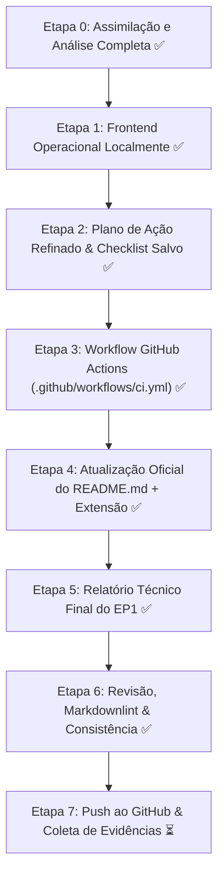

<!-- markdownlint-disable -->

# Plano de Ação Refinado — Entregável Parcial 1 (EP1): Projeto Integrado 4 (PI4)

**Disciplina:** Projeto Integrado 4 — Disciplina Integrada: Integração de Sistemas  
**Instituição:** Universidade Federal do Cariri (UFCA)  
**Curso:** Análise e Desenvolvimento de Sistemas  
**Discentes:** Antonio Alex Dayson Tomaz e Maria Alexsandra Tomaz  
**Tema:** Configuração de Processo de Integração Contínua (CI) com GitHub Actions no Projeto TrAcEs  

---

## 🎯 1. Objetivo Geral do Entregável Parcial 1 (EP1)

Estruturar, implementar e validar em ambiente local (com posterior sincronização com o GitHub) um processo robusto e automatizado de **Integração Contínua (CI)** utilizando o **GitHub Actions**. O pipeline garantirá a integridade do código através da execução automatizada da suíte de testes existente do backend com Pytest (com isolamento do banco SQLite e persistência de relatórios) e validação da compilação de produção do frontend SPA com Vite (`npm run build`), acompanhado da renovação integral do `README.md` (com foco no Componente Extensionista) e do Relatório Técnico Final aprofundado.

---

## 📋 2. Checklist Geral do Plano de Ação

- [x] **Etapa 0:** Análise e assimilação integral das orientações, critérios, documentos e bases de código (backend, testes, frontend e histórico de docs). *(Concluída)*
- [x] **Etapa 1:** Preparação e validação do frontend em ambiente local (instalação de dependências e verificação de build sem alterações estruturais ou quebra de desacoplamento). *(Concluída)*
- [x] **Etapa 2:** Elaboração e refinamento do Plano de Ação Assertivo em etapas com Checklist e salvamento do arquivo `.md`. *(Concluída)*
- [x] **Etapa 3:** Criação e parametrização do fluxo de Integração Contínua `.github/workflows/ci.yml` funcional, abordando jobs desacoplados de backend e frontend com cache, isolamento, timeout, menor privilégio, build check, verificação de tipos (`tsc --noEmit`), gatilho manual (`workflow_dispatch`) e executor local (`scripts/ci_local.py`). *(Concluída)*
- [x] **Etapa 4:** Atualização oficial do `README.md` do repositório, incluindo seções detalhadas de CI/CD, arquitetura do pipeline, operação no GitHub, troubleshooting, critérios de aceite e a seção dedicada ao **[Componente Extensionista]**. *(Concluída)*
- [x] **Etapa 5:** Redação aprofundada do **Relatório Final de Atendimento aos Requisitos do EP1** respondendo a todas as perguntas dos itens 1.1, 1.2 (a, b, c, componente extensionista) e 2, com matrizes de rastreabilidade, análise de limitações, referências e anexos. *(Concluída)*
- [x] **Etapa 6:** Revisão geral, configuração de regras de markdownlint, verificação dos critérios avaliativos e ajustes finais de consistência entre os três documentos. *(Concluída)*
- [x] **Etapa 7a:** Histórico com autoria correta criado e publicado no repositório oficial; pipeline aprovado no GitHub Actions (aba *Actions*). *(Concluída)*
- [x] **Etapa 7b:** Coleta dos prints de evidência em `docs/assets/ci/` e inserção no relatório. *(Concluída)*
- [ ] **Etapa 7c (opcional):** Configuração de *branch protection* exigindo os dois jobs como checks obrigatórios. *(Opcional — não é requisito do EP1)*

> **Legenda de status:** `[x]` concluído e verificável no repositório local · `[ ]` pendente de ação externa ou melhoria opcional (indicado no item).

---

## 🗺️ 3. Diagrama do Fluxo de Execução das Etapas



---

## 🔎 4. Diretrizes Técnicas e Refinamentos Assertivos Incorporados

Com base na análise técnica das especificações do projeto e das melhores práticas de CI/CD, os seguintes refinamentos norteiam a execução:

### 4.1 Dimensionamento da Suíte de Testes (Sem Premissas Antecipadas)
* O plano adota a terminologia formal: **"execução automatizada da suíte de testes existente do backend com Pytest"**.
* A quantificação exata de testes coletados é tratada como um dado empírico da versão avaliada (aferido via `python -m pytest --collect-only -q`), o qual será registrado formalmente no relatório técnico e evidenciado nos logs do pipeline, garantindo que o plano permaneça desacoplado de alterações futuras no volume de casos de teste.

### 4.2 Estratégia de Execução dos Testes e Relatório de Saída
* A execução do Pytest no pipeline de CI utilizará saída detalhada no log (`python -m pytest -v`) e **geração de relatório persistido em formato JUnit XML**:
  ```bash
  python -m pytest -v --junitxml=reports/pytest-results.xml
  ```
* O arquivo de relatório gerado em `reports/pytest-results.xml` será persistido como artefato transferível do job no GitHub Actions utilizando a action oficial `actions/upload-artifact@v6`.

### 4.3 Escopo Real das Tarefas Automatizadas (Sem Promessas Falsas de Lint)
* O pipeline executa apenas tarefas reais e comprovadamente existentes na base de código:
  1. **Backend — build check:** `python -m compileall -q backend/src backend/main.py` valida a sintaxe de todos os módulos.
  2. **Backend — testes:** execução da suíte unitária e de integração com Pytest, isolamento de SQLite e relatório JUnit XML.
  3. **Frontend — verificação de tipos:** `npm run typecheck` executa `tsc --noEmit` com o `tsconfig.json` versionado e bloqueia o job em caso de erro.
  4. **Frontend — instalação e build:** `npm ci` (determinístico, baseado no `package-lock.json`) e `npm run build` (`vite build`).
* **Separação de responsabilidades:** o typecheck cobre contratos de tipo; o build cobre resolução de módulos e empacotamento. A existência da checagem de tipos foi verificada empiricamente: a primeira execução revelou 11 erros, todos corrigidos, e a etapa hoje passa limpa.
* Como o projeto não possui ferramentas de lint dedicadas (Ruff, Flake8 ou ESLint), o plano e o workflow **não declaram etapas de lint inexistentes**, mantendo conformidade estrita com o requisito de possuir ao menos uma tarefa automatizada funcional.

### 4.4 Definição do Gerenciador de Pacotes Baseada no Lockfile
* A verificação da estrutura da pasta `frontend/` confirmou a presença do arquivo de bloqueio oficial `package-lock.json`.
* Dessa forma, o gerenciador adotado no pipeline de CI é estritamente o **NPM**, utilizando o comando determinístico e reproduzível:
  ```bash
  npm ci
  ```
  evitando instalações soltas com `npm install` e divergências de resolução de dependências no runner.

### 4.5 Fixação das Versões dos Runtimes
* **Node.js:** Fixado na versão comprovadamente compatível com a base local e dependências do Vite 6: `node-version: "22.20.0"`.
* **Python:** Configurado em `python-version: "3.12"`, cuja compatibilidade com o ecossistema Clean Architecture, SQLite 3 embarcado e suíte de testes foi integralmente comprovada na execução local.

### 4.6 Mapeamento da Estrutura do Monorepo e Cache de Dependências
* O pipeline considera a organização em subdiretórios do monorepo, definindo expressamente os caminhos de lockfile e diretórios de execução:
  * **Job Backend:**
    * Cache: `cache: "pip"` com `cache-dependency-path: backend/requirements.txt`.
    * Execução: disparada a partir da raiz do repositório aproveitando o arquivo [`pytest.ini`](file:///c:/Users/Dayson/Documents/pi_4_ep_1/pytest.ini) já configurado (`pythonpath = backend`, `testpaths = backend/tests`, `norecursedirs = .venv node_modules frontend .git`).
  * **Job Frontend:**
    * Diretório padrão: `defaults: run: working-directory: frontend`.
    * Cache: `cache: "npm"` com `cache-dependency-path: frontend/package-lock.json`.

### 4.7 Isolamento Estrito do Banco de Dados SQLite
* Os testes de integração do projeto já implementam fixtures isoladas baseadas em `tmp_path_factory.mktemp("data")`, gerando bancos temporários (`test_api.db`) em tempo de execução que são destruídos ao final de cada sessão de teste.
* Essa estratégia garante que o arquivo físico de desenvolvimento (`backend/src/infrastructure/school.db`) jamais seja consumido, modificado ou acoplado ao ambiente efêmero do runner de CI.

### 4.8 Política Transparente de Badges
* O `README.md` apresenta badges funcionais e auditáveis:
  * **Status do Workflow do GitHub Actions:** badge oficial gerado pela URL do repositório informando o estado da pipeline de CI.
  * **Badges Tecnológicos Informativos:** versões das tecnologias validadas (Python 3.12, Node 22, React 18, Vite 6, SQLite 3).
* O README registra explicitamente que, antes do primeiro `push`, o badge retorna `404`/`no status` — comportamento esperado, não relacionado ao código.
* Não será emitido badge formal de conformidade "WCAG 2.1 AA", uma vez que o escopo do EP1 não compreende auditoria automatizada de acessibilidade via CI; os princípios de acessibilidade WCAG e heurísticas de Nielsen são descritos em seção textual técnica dedicada como compromisso e diretriz de engenharia.

### 4.9 Cronograma Relativo e Responsáveis
* Cronograma planejado em dias relativos à data de entrega (D-0 = 02/11/2026), com divisão equilibrada entre os dois discentes.

| Etapa | Janela planejada | Responsável principal | Apoio | Evidência da conclusão |
| :--- | :--- | :--- | :--- | :--- |
| Etapa 0 — Assimilação | D-6 a D-5 | Antonio Alex Dayson Tomaz | Maria Alexsandra Tomaz | Checklist de leitura dos arquivos de apoio |
| Etapa 1 — Frontend local | D-4 | Maria Alexsandra Tomaz | Antonio Alex Dayson Tomaz | `npm run build` concluído em `frontend/dist/` |
| Etapa 2 — Plano de ação | D-4 | Antonio Alex Dayson Tomaz | Maria Alexsandra Tomaz | Este documento versionado |
| Etapa 3 — Workflow CI | D-3 | Antonio Alex Dayson Tomaz | Maria Alexsandra Tomaz | `.github/workflows/ci.yml` |
| Etapa 4 — README | D-2 | Maria Alexsandra Tomaz | Antonio Alex Dayson Tomaz | Seções 1 a 7 do `README.md` |
| Etapa 5 — Relatório | D-1 a D-0 | Antonio Alex Dayson Tomaz | Maria Alexsandra Tomaz | `RELATORIO_FINAL_PI4_EP1.md` |
| Etapa 6 — Revisão | D-0 | Ambos | — | `.markdownlint.json` + checklist final |
| Etapa 7 — Evidências remotas | D+1 | Antonio Alex Dayson Tomaz | Maria Alexsandra Tomaz | Prints em `docs/assets/ci/` |

### 4.10 Riscos Identificados e Mitigações

| Risco | Probabilidade | Impacto | Mitigação adotada |
| :--- | :---: | :---: | :--- |
| Divergência entre ambiente local e runner | Alta | Médio | Versões fixadas (`python-version: 3.12`, `node-version: 22.20.0`), `npm ci` e `pytest.ini` versionado |
| `npm ci` falhar por lockfile dessincronizado | Média | Alto | `package-lock.json` versionado e instalação validada localmente antes do commit |
| Testes acoplados ao `school.db` de desenvolvimento | Média | Alto | **Materializado na 1ª execução**: 2 testes falharam no runner limpo; corrigidos com banco temporário semeado e cache de `DatabaseManager` por caminho |
| Consumo excessivo de minutos do runner | Baixa | Médio | `timeout-minutes: 15` e `concurrency: cancel-in-progress: true` |
| Banco de desenvolvimento vazando para o CI | Baixa | Alto | Fixtures com `tmp_path_factory.mktemp` e `.gitignore` cobrindo `*.db`, `*.sqlite`, `reports/` |
| Print da aba *Actions* indisponível antes do `push` | Alta | Alto | Status declarado como pendente no README e no relatório + Etapa 7 com roteiro e nomes de arquivo definidos |
| Erro de tipo não detectado no frontend | Baixa | Médio | Etapa bloqueante `npm run typecheck` (`tsc --noEmit`) no job `frontend-ci` e execução local pelo runner |
| Testes dependentes de rede ou estado global | Baixa | Médio | Suíte usa biblioteca padrão e SQLite embarcado; nenhuma chamada externa obrigatória |

### 4.11 Matriz de Rastreabilidade: Requisito → Etapa → Artefato → Evidência

| Requisito do EP1 | Etapa | Artefato principal | Evidência de atendimento |
| :--- | :---: | :--- | :--- |
| **REQ-01** Arquivo `.yml` funcional em `.github/workflows/` | 3 | `.github/workflows/ci.yml` | Arquivo versionado, com triggers (`push`, `pull_request`, `workflow_dispatch`), `permissions`, jobs, cache, timeout e artefato |
| **REQ-02** Ao menos uma tarefa automatizada | 3 | `ci.yml` (build check, Pytest, `tsc --noEmit` e Vite) | ✅ `79 passed` + typecheck + build no runner Linux (aba *Actions*) |
| **REQ-03** README explicativo da configuração e objetivo do CI | 4 | `README.md` (Seções 1.1 a 1.6) | Diagrama Mermaid, detalhamento dos jobs, reprodução local, operação e troubleshooting |
| **REQ-04** Componente Extensionista no README | 4 | `README.md` (Seção 2) | Texto autoral com metáfora didática e benefícios para iniciantes |
| **REQ-05** Organização do repositório | 1, 2, 6 | Monorepo, `.gitignore`, `pytest.ini`, `.markdownlint.json` | Estrutura descrita no README e ausência de artefatos gerados versionados |
| **Critérios avaliativos** (pipeline, YAML, organização, README, relatório) | 3 a 6 | `RELATORIO_FINAL_PI4_EP1.md` (Seção 1.5) | Matriz de critérios × evidências com status explícito |

### 4.12 Melhorias e Ajustes Recomendados (Backlog Técnico)

| Item | Motivo | Prioridade |
| :--- | :--- | :---: |
| Evoluir o `tsconfig.json` para `strict: true` de forma incremental | A checagem de tipos já existe, mas em modo permissivo nesta primeira adoção | Média |
| Avaliar a pasta `backend/src/infrastructure/api/` (arquivos com 1 linha) e a coexistência com `backend/src/presentation/` | Eliminar stubs/duplicações que enfraquecem a afirmação de separação estrita de camadas | Média |
| Adicionar lint (Ruff/Flake8 no backend e ESLint no frontend) | Ampliar a cobertura estática do pipeline | Média |
| Adicionar `pytest --cov` com publicação de cobertura | Dar visibilidade quantitativa à qualidade dos testes | Média |
| Configurar Dependabot e *branch protection* com checks obrigatórios | Manter dependências atualizadas e impedir merge com pipeline vermelho | Média |
| Automatizar a simulação local com `act` em um script único | Unificar execução local e simulação fiel do runner | Baixa |

---

## 🛠️ 5. Detalhamento Técnico das Etapas Executadas

### 🔹 Etapa 3: Criação do Workflow do GitHub Actions (`.github/workflows/ci.yml`)

* **Objetivo:** Criar o diretório `.github/workflows/` e o arquivo de pipeline `.yml` com conformidade sintática, jobs desacoplados, cache eficiente, relatório de testes persistido e execução sob demanda.
* **Tarefas da Etapa 3:**
  1. Criação do diretório `.github/workflows/` na raiz do projeto.
  2. Implementação do arquivo `ci.yml` contendo:
     - Triggers em eventos de `push`, `pull_request` e `workflow_dispatch` (execução manual com campo opcional `motivo`, refletido no `run-name`).
     - `concurrency` com `cancel-in-progress: true` e `permissions: contents: read` (menor privilégio).
     - **Job 1: Backend CI (`backend-ci`):**
       - Runner `ubuntu-24.04` fixo com `timeout-minutes: 15`.
       - Setup Python 3.12 com cache `pip` apontando para `backend/requirements.txt`.
       - Instalação das dependências com `pip install -r backend/requirements.txt`.
       - Build check de sintaxe: `python -m compileall -q backend/src backend/main.py`.
       - Execução dos testes via Pytest gerando saída detalhada no log e arquivo XML: `python -m pytest -v --junitxml=reports/pytest-results.xml`.
       - Persistência do relatório de testes via `actions/upload-artifact@v6` (`if: always()`, `retention-days: 14`, `if-no-files-found: warn`).
     - **Job 2: Frontend CI (`frontend-ci`):**
       - Runner `ubuntu-24.04` fixo com `timeout-minutes: 15` e `working-directory: frontend`.
       - Setup Node.js 22.20.0 com cache `npm` apontando para `frontend/package-lock.json`.
       - Instalação determinística via `npm ci`.
       - Verificação de tipos: `npm run typecheck` (`tsc --noEmit` com `frontend/tsconfig.json`).
       - Compilação e empacotamento do bundle: `npm run build` (transpilação esbuild).
  3. Validação estrutural do arquivo YAML contra o schema oficial do GitHub Actions e teste de sintaxe via parser.
  4. Criação do executor local `scripts/ci_local.py`, que reproduz as quatro verificações e aceita `--install`, `--backend-only`, `--frontend-only` e `--no-build`.

### 🔹 Etapa 4: Atualização e Estruturação do `README.md` Oficial

* **Objetivo:** Transformar o rascunho de migração (`README-para atualizar-para o pi_4_ep_1.md`) no `README.md` definitivo do PI4-EP1 na raiz do repositório.
* **Tarefas da Etapa 4:**
  1. Atualização dos metadados acadêmicos para **Projeto Integrado 4 (PI4) — Entregável Parcial 1 (EP1)** e disciplina **Integração de Sistemas**.
  2. Inclusão dos badges oficiais do GitHub Actions e pilhas tecnológicas validadas, com nota sobre o comportamento do badge antes do primeiro `push`.
  3. Redação da seção técnica de **Integração Contínua (CI)** com diagrama visual em Mermaid ilustrando o fluxo dos jobs de backend e frontend.
  4. Inclusão das instruções para replicação local dos testes antes de commits/pushes, incluindo o atalho `python scripts/ci_local.py`.
  5. Redação aprofundada da seção **[Componente Extensionista]**, traduzindo em linguagem didática o valor da integração contínua para estudantes iniciantes e comunidade da UFCA.
  6. Inclusão das seções de **operação no GitHub** (primeira publicação, download de artefatos, proteção de branch, *re-run*), de **execução manual sob demanda** (`workflow_dispatch`, `gh workflow run`, `act`) e de **troubleshooting** (sintoma → causa → correção).
  7. Inclusão do checklist de **critérios de aceite (Definition of Done)** e da nota de padronização do gerenciador de pacotes (NPM, não PNPM).

### 🔹 Etapa 5: Redação do Relatório Final do EP1 com Respostas Aprofundadas

* **Objetivo:** Responder de forma aprofundada, técnica e fundamentada a todas as perguntas do arquivo `perguntas_para_serem_respondidas_relatorio_finalpi_4_ep_1.txt`.
* **Tarefas da Etapa 5:**
  1. **Item 1.1:** Análise e evidências do atendimento a cada requisito do EP1, com matriz de rastreabilidade.
  2. **Item 1.2:** Reflexão prática da geração de valor e impacto social/extensionista.
  3. **Item 1.2 (a):** Explicação da arquitetura do arquivo `.github/workflows/ci.yml`.
  4. **Item 1.2 (b):** Descrição das quatro tarefas automatizadas (build check, Pytest, `tsc --noEmit` e Vite) e mitigação de regressões.
  5. **Item 1.2 (c):** Estrutura do `README.md` e estratégia pedagógica do componente extensionista.
  6. **Item [Componente Extensionista]:** Texto extensionista autoral para a comunidade acadêmica e externa.
  7. **Item 2:** Demonstração do funcionamento do GitHub Actions e **plano de coleta de evidências visuais** com nomes de arquivo e status por item.
  8. **Seções complementares:** conformidade com o roteiro original de perguntas (1.3), revisão de conceitos e artefatos anteriores (1.4), critérios avaliativos × evidências (1.5) e anexos com o YAML completo e o `pytest.ini` (9).

### 🔹 Etapa 6: Revisão, Ajustes, Validação Markdownlint e Checklist Final

* **Objetivo:** Garantir a conformidade estrita de todos os artefatos com as normas acadêmicas, formatação técnica e regras do markdownlint.
* **Tarefas da Etapa 6:**
  1. Auditoria e validação de conformidade de todos os arquivos `.md` criados ou atualizados, com regras centralizadas em `.markdownlint.json` (ex.: `MD013` desabilitada para tabelas e URLs longas).
  2. Verificação de integridade cruzada contra os critérios avaliativos da disciplina.
  3. Revisão de coerência entre `README.md`, `RELATORIO_FINAL_PI4_EP1.md` e este plano (números de teste, nomes de jobs, comandos e status de evidências).
  4. Atualização final do checklist, com separação explícita entre itens concluídos e pendentes de ação externa.

### 🔹 Etapa 7: Sincronização com o GitHub e Coleta de Evidências

* **Objetivo:** Publicar o repositório, executar o pipeline na infraestrutura do GitHub Actions e capturar as evidências visuais exigidas pelo Item 2 do roteiro.
* **Tarefas da Etapa 7 (em andamento):**
  1. ✅ Executar os commits com autoria correta, seguindo [`docs/GUIA_COMMITS_AUTORIA.md`](docs/GUIA_COMMITS_AUTORIA.md) (C1–C5).
  2. ✅ Criar o repositório remoto e configurar `git remote add origin`.
  3. ✅ Enviar a branch principal (`git push -u origin main`) — execução verde na aba *Actions*.
  4. ✅ Confirmar os jobs `backend-ci` e `frontend-ci` aprovados e o artefato `pytest-results-report` publicado.
  5. ⏳ Capturar os seis prints previstos na Seção 7.4 do relatório em `docs/assets/ci/`.
  6. ⏳ Inserir as imagens no relatório e atualizar os status de ⏳ para ✅.
  7. ⏳ (Opcional) Habilitar *branch protection* exigindo os dois jobs como checks obrigatórios.
