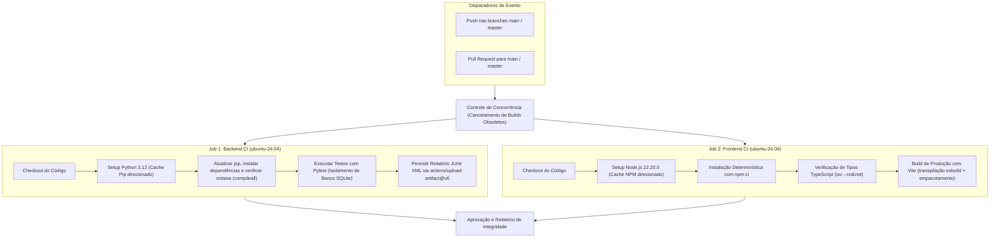

<!-- markdownlint-disable -->

# TrAcEs — Trilha de Acompanhamento Estudantil

[](https://github.com/alexdaysonufca/sistema_acompanhamento_escolar_pi4_ep1/actions/workflows/ci.yml)


**Projeto:** TrAcEs — Trilha de Acompanhamento Estudantil  
**Entregável:** Entregável Parcial 1 (EP1) — Configuração de Processo de Integração Contínua com GitHub Actions  
**Disciplina:** Projeto Integrado 4  
**Disciplina Integrada:** Integração de Sistemas  
**Instituição:** Universidade Federal do Cariri (UFCA)  
**Curso:** Análise e Desenvolvimento de Sistemas  
**Estudantes:** Antonio Alex Dayson Tomaz e Maria Alexsandra Tomaz  
**Data:** 02/11/2026  
**Status do Projeto:** ✅ Pipeline de CI **aprovado no GitHub Actions** (79 testes, `tsc --noEmit` e build Vite verdes) · Execução sob demanda via `workflow_dispatch` e runner local `scripts/ci_local.py` · Clean Architecture 4 Camadas · Monorepo Desacoplado

**Documentação Complementar:** [Plano de Ação do EP1](PLANO_DE_ACAO_PI4_EP1.md) · [Relatório Técnico Final de Atendimento aos Requisitos](RELATORIO_FINAL_PI4_EP1.md)

---

## 🚀 1. Integração Contínua (CI) com GitHub Actions

O **Entregável Parcial 1 (EP1)** da disciplina de Projeto Integrado 4 (Integrada com *Integração de Sistemas*) implementa a automação completa do ciclo de integração de código através do **GitHub Actions**. O objetivo é assegurar que todas as alterações submetidas ao repositório sejam checadas automaticamente contra erros de lógica, quebras de compilação e regressões de funcionalidades.

### 1.1 Diagrama do Pipeline de CI (`.github/workflows/ci.yml`)

O workflow é disparado automaticamente a cada `push` ou abertura de `pull_request` nas branches principais (`main` e `master`):



### 1.2 Detalhamento Técnico dos Jobs Automatizados

O pipeline foi estruturado de forma desacoplada no arquivo [`.github/workflows/ci.yml`](file:///.github/workflows/ci.yml), contemplando dois jobs paralelos e independentes:

#### 🔹 Job 1: `backend-ci` (Backend CI — Testes Pytest & Isolamento SQLite)
* **Runner:** `ubuntu-24.04` fixo (evita a migração automática do rótulo `ubuntu-latest`) com `timeout-minutes: 15`, impedindo que execuções travadas consumam minutos indefinidamente.
* **Segurança do Workflow:** declaração de `permissions: contents: read` no nível do arquivo, aplicando o princípio do menor privilégio (o pipeline lê o código e não escreve no repositório).
* **Runtime:** Python `3.12` com gerenciamento de cache nativo via `cache: "pip"` apontando diretamente para `cache-dependency-path: backend/requirements.txt`.
* **Resolução Universal de Imports:** Executado a partir da raiz do monorepo, aproveitando a configuração do [`pytest.ini`](file:///pytest.ini) (`pythonpath = backend`), garantindo que o módulo `src` seja resolvido uniformemente tanto no runner quanto no ambiente local.
* **Verificação de Compilação (build check):** execução de `python -m compileall -q backend/src backend/main.py`, que valida a sintaxe de todos os módulos Python antes da etapa de testes, sem exigir dependências adicionais.
* **Isolamento do Banco de Dados SQLite:** Os testes utilizam fixtures baseadas em diretórios temporários (`tmp_path_factory.mktemp`), instanciando bancos efêmeros que são criados e destruídos a cada execução. O arquivo local de desenvolvimento (`backend/src/infrastructure/school.db`) **não é tocado nem versionado**, garantindo repetibilidade pura sem efeitos colaterais.
* **Geração e Persistência do Relatório:**
  ```bash
  python -m pytest -v --junitxml=reports/pytest-results.xml
  ```
  O relatório gerado é persistido como artefato oficial da execução através da action `actions/upload-artifact@v6`, com `if: always()` (preserva o XML mesmo em caso de falha), `retention-days: 14` e `if-no-files-found: warn` (evita uma segunda falha encadeada quando a etapa anterior interrompe a geração do arquivo).

#### 🔹 Job 2: `frontend-ci` (Frontend CI — Instalação Determinística & Build Vite)
* **Runner:** `ubuntu-24.04` fixo com `timeout-minutes: 15`.
* **Diretório de Trabalho:** `working-directory: frontend`.
* **Runtime:** Node.js `22.20.0` com cache oficial via `cache: "npm"` indexado pelo `cache-dependency-path: frontend/package-lock.json`.
* **Instalação Determinística:** Utilização estrita do comando:
  ```bash
  npm ci
  ```
  garantindo que exatamente as versões congeladas no `package-lock.json` sejam instaladas, eliminando variações de pacotes.
* **Verificação de Tipos TypeScript:** Execução de:
  ```bash
  npm run typecheck
  ```
  que corresponde a `tsc --noEmit` com a configuração de [`frontend/tsconfig.json`](file:///frontend/tsconfig.json) (`noEmit`, `moduleResolution: bundler`, alias `@/*`, `strict: false` nesta primeira adoção). A etapa é **bloqueante**: erros de tipo, imports inexistentes e incompatibilidades de contrato reprovam o job antes do build.
* **Compilação e Empacotamento de Produção:** Execução de:
  ```bash
  npm run build
  ```
  que corresponde ao script `"build": "vite build"` do [`frontend/package.json`](file:///frontend/package.json). O Vite 6 transpila os arquivos `.ts`/`.tsx` com **esbuild**, resolve imports e aliases (`@` → `src`) e empacota o bundle em `dist/`.
* **Divisão de responsabilidades entre as etapas:** o `typecheck` valida os contratos de tipo; o `vite build` valida a resolução de módulos e gera o artefato final. Juntas, cobrem erros estáticos e de empacotamento.

### 1.3 Reprodução Local dos Passos de Integração Contínua

Antes de enviar novos commits para o repositório remoto, qualquer desenvolvedor pode executar os mesmos passos realizados pelo runner de CI:

```bash
# 1. Verificar a sintaxe dos módulos Python (na raiz):
python -m compileall -q backend/src backend/main.py

# 2. Executar os testes do backend com geração de relatório XML (na raiz):
python -m pytest -v --junitxml=reports/pytest-results.xml

# 3. Executar a instalação, a checagem de tipos e o build do frontend (dentro de frontend/):
cd frontend
npm ci
npm run typecheck
npm run build
```

> **Atalho:** o script [`scripts/ci_local.py`](scripts/ci_local.py) executa as quatro etapas de uma vez (`compileall`, `pytest`, `typecheck` e `build`), permitindo validar a automação a qualquer momento, sem depender de `push` ou do GitHub:
> ```bash
> python scripts/ci_local.py              # execução completa
> python scripts/ci_local.py --install    # força npm ci antes das etapas do frontend
> python scripts/ci_local.py --backend-only
> python scripts/ci_local.py --frontend-only --no-build
> ```

> **Modos recomendados:**
> - **Checagem rápida, sem build:** `python scripts/ci_local.py --no-build`
> - **Checagem completa e fiel ao CI (com `npm ci` limpo e build):** `python scripts/ci_local.py --install`

### 1.4 Operação da Pipeline no GitHub (Primeira Publicação)

O desenvolvimento do EP1 ocorreu integralmente em IDE local. Para ativar a execução pública do workflow, o roteiro é:

1. **Criar o repositório remoto** no GitHub (sugestão de nome: `pi_4_ep_1`).
2. **Conectar e enviar o histórico local:**
   ```bash
   git init
   git add .
   git commit -m "feat(ci): pipeline de integração contínua com GitHub Actions"
   git branch -M main
   git remote add origin https://github.com/alexdaysonufca/sistema_acompanhamento_escolar_pi4_ep1.git
   git push -u origin main
   ```
3. **Conferir a execução:** acessar `https://github.com/alexdaysonufca/sistema_acompanhamento_escolar_pi4_ep1/actions` e verificar os jobs `backend-ci` e `frontend-ci` concluídos com sucesso.
4. **Baixar o artefato:** no resumo da execução (*Run Summary*), baixar `pytest-results-report` (contém `pytest-results.xml`).
5. **Validar o badge:** o selo no topo deste README é atualizado automaticamente para `passing` após a primeira execução bem-sucedida na branch padrão.
6. **Proteger a branch (recomendado):** em *Settings → Branches → Add branch protection rule*, habilitar *Require status checks to pass before merging* e selecionar os jobs `Backend CI (Testes Pytest & Isolamento SQLite)` e `Frontend CI (Instalação Determinística & Build Vite)`.
7. **Repetir falhas:** em *Actions → execução → Re-run all jobs* é possível reexecutar o pipeline sem novo commit, útil para diagnosticar falhas intermitentes de infraestrutura.

> **Observação sobre o badge:** o selo reflete a última execução na branch padrão e deve exibir `passing` enquanto o pipeline estiver verde.

#### Execução Manual sob Demanda (`workflow_dispatch`)

O pipeline **não depende de `push`** para rodar. O gatilho `workflow_dispatch` está declarado no workflow, permitindo validar a automação no momento desejado:

1. **Pela interface do GitHub:** *Actions → CI - TrAcEs → Run workflow*, selecionando a branch e, opcionalmente, o campo `motivo` — o valor informado compõe o nome da execução (`run-name`), facilitando a identificação no histórico.
2. **Pela GitHub CLI:**
   ```bash
   gh workflow run ci.yml
   gh workflow run ci.yml -f motivo="Validação antes da entrega"
   gh run list --workflow=ci.yml
   gh run watch
   ```
3. **Totalmente local (sem GitHub):**
   ```bash
   python scripts/ci_local.py
   ```
   reproduz as mesmas quatro verificações no computador do desenvolvedor.
4. **Simulação do runner com `act` (opcional, requer Docker):**
   ```bash
   act workflow_dispatch -j backend-ci
   act workflow_dispatch -j frontend-ci
   ```

### 1.5 Solução de Problemas Comuns (Troubleshooting)

| Sintoma no pipeline | Causa provável | Ação corretiva |
| :--- | :--- | :--- |
| `npm ci` falha com `EUSAGE` | `package.json` e `package-lock.json` divergentes | Executar `npm install` localmente e versionar o lockfile atualizado |
| Erro de import `src.*` nos testes | `pytest.ini` ausente ou `pythonpath` incorreto | Garantir `pythonpath = backend` e executar o pytest a partir da raiz |
| `No files were found with the provided path: reports/` | A etapa de testes falhou antes de gerar o XML | Verificar o log do pytest; o aviso é esperado e não invalida a causa raiz |
| `tsc` reprova o job (`npm run typecheck`) | Contrato de tipo divergente entre `frontend/src/types/api.ts` e o uso no componente | Corrigir a interface ou o uso; reproduzir localmente com `npm run typecheck` |
| Badge exibindo `no status` ou `404` | Workflow nunca executado no remoto ou caminho/nome do repositório divergente | Conferir a URL do badge e o nome do arquivo `ci.yml` |
| Opção *Run workflow* não aparece | `workflow_dispatch` ausente ou workflow ainda não presente na branch padrão | Enviar o `ci.yml` atualizado e conferir em *Actions* |
| Build do frontend falha por alias `@/...` | O alias precisa existir em `resolve.alias` (Vite) e em `paths` (tsconfig) | Verificar [`frontend/vite.config.ts`](file:///frontend/vite.config.ts) e [`frontend/tsconfig.json`](file:///frontend/tsconfig.json) |
| Versão de Python divergente do ambiente local | Runner usa `3.12` fixado, ambiente local pode usar outra versão | Padronizar o ambiente local em Python 3.12 ou ajustar `python-version` |

### 1.6 Critérios de Aceite (Definition of Done do EP1)

- [x] Arquivo `.yml` válido e versionado em `.github/workflows/`.
- [x] Pelo menos uma tarefa automatizada funcional — o projeto possui **quatro**: build check Python (`compileall`), testes (`pytest`), checagem de tipos (`tsc --noEmit`) e build do frontend (`vite build`).
- [x] Suíte de testes executada com isolamento de banco e relatório JUnit XML persistido como artefato.
- [x] Instalação determinística do frontend com `npm ci` baseada em lockfile versionado.
- [x] Execução sob demanda habilitada via `workflow_dispatch` (interface do GitHub, `gh workflow run` e `act`).
- [x] Executor local do pipeline disponível em [`scripts/ci_local.py`](scripts/ci_local.py).
- [x] README com objetivo, arquitetura do pipeline, instruções de reprodução local, operação no GitHub e troubleshooting.
- [x] Seção `[Componente Extensionista]` autoral, em linguagem acessível, sobre o valor da CI para quem aprende a programar.
- [x] Evidências visuais (prints da aba *Actions*, do artefato e do badge) anexadas ao relatório em `docs/assets/ci/`.

### 1.7 Como Verificar o Processo de CI Implementado

O processo pode ser verificado em quatro camadas: **execução real no GitHub Actions**, **artefato gerado**, **badge** e **reprodução local**.

#### 1.7.1 Verificação no GitHub Actions (execução real)

1. Acesse a aba **Actions** do repositório: `https://github.com/alexdaysonufca/sistema_acompanhamento_escolar_pi4_ep1/actions`.
2. Selecione a execução mais recente do workflow **CI - TrAcEs**.
3. Confirme o status **Success** (check verde) e os dois jobs:
   - **Backend CI (Testes Pytest & Isolamento SQLite)**;
   - **Frontend CI (Instalação Determinística & Build Vite)**.
4. Expanda o job `backend-ci` e confira as etapas:
   - checkout do código;
   - setup do Python 3.12 com cache do `pip`;
   - instalação das dependências;
   - verificação de compilação sintática (`compileall`);
   - execução da suíte Pytest com `79 passed`;
   - upload do artefato `pytest-results-report`.
5. Expanda o job `frontend-ci` e confira as etapas:
   - checkout do código;
   - setup do Node.js 22.20.0 com cache do `npm`;
   - `npm ci`;
   - `npm run typecheck` (`tsc --noEmit`);
   - `npm run build` (Vite).
6. No resumo da execução (*Run Summary*), baixe o artefato **pytest-results-report** e confirme o arquivo `pytest-results.xml`.

#### 1.7.2 Verificação do badge

O badge no topo deste README consulta o workflow `ci.yml` na branch padrão. Se exibir `passing`, a última execução está verde; se exibir `failing`, há regressão. O badge não substitui a inspeção dos jobs.

#### 1.7.3 Verificação dos gatilhos

| Gatilho | Como verificar |
| :--- | :--- |
| `push` | Faça um commit em `main` e confira uma nova execução na aba Actions |
| `pull_request` | Abra um PR para `main` e verifique o check no PR |
| `workflow_dispatch` | *Actions → CI - TrAcEs → Run workflow* (ou `gh workflow run ci.yml`) |

#### 1.7.4 Reprodução local

```bash
python scripts/ci_local.py --no-build   # checagem rápida, sem build
python scripts/ci_local.py --install    # fiel ao CI: npm ci limpo + build
```

O runner local deve terminar com `Resultado: todas as ... etapas foram concluídas com sucesso.` e código de saída `0`.

#### 1.7.5 Checklist de verificação

- [ ] Workflow `CI - TrAcEs` aparece na aba Actions.
- [ ] Jobs `backend-ci` e `frontend-ci` concluídos com sucesso.
- [ ] Etapa de Pytest exibe `79 passed`.
- [ ] Etapa `tsc --noEmit` sem erros.
- [ ] Etapa `vite build` concluída.
- [ ] Artefato `pytest-results-report` disponível.
- [ ] Badge exibindo `passing`.
- [ ] Disparo manual disponível em *Run workflow*.
- [ ] Runner local termina com código `0`.

---

## 🌐 2. [Componente Extensionista] Integração Contínua Descomplicada: Do Conceito à Prática para Estudantes e Comunidade

> **Objetivo Extensionista:** Tornar os conceitos fundamentais de Engenharia de Software e Integração de Sistemas acessíveis, claros e úteis para discentes em fase inicial da graduação na Universidade Federal do Cariri (UFCA), estudantes de escolas técnicas e entusiastas de programação da comunidade.

### 2.1 O que é Integração Contínua (CI)?

Imagine que você e um grupo de colegas estão escrevendo um livro juntos. Se cada um passar meses escrevendo seus capítulos sozinho no próprio computador e deixar para juntar todos os textos apenas no dia da entrega final, o resultado previsível será o caos: capítulos com estilos de escrita conflitantes, termos técnicos usados de formas contraditórias, repetições de parágrafos e horas intermináveis gastas tentando formatar o arquivo final.

No desenvolvimento de software acontece exatamente a mesma coisa. Quando múltiplos programadores passam semanas trabalhando isoladamente em seus computadores ("na minha máquina funciona"), a tarefa de juntar todas as partes ao final — chamada de integração — costuma ser extremamente dolorosa e repleta de falhas inesperadas.

A **Integração Contínua (do inglês *Continuous Integration* ou simplesmente *CI*)** é a prática de **integrar e testar o código frequentemente** — várias vezes ao dia. Em vez de esperar pelo fim do semestre ou da sprint, cada pequena melhoria ou correção feita no código é enviada para um repositório central compartilhado (como o GitHub). Assim que o código chega, um sistema automatizado entra em ação imediatamente, simulando um computador limpo e neutro que:
1. Baixa o código recém-enviado;
2. Instala todas as dependências e ferramentas necessárias;
3. Executa baterias de testes automatizados para verificar se as regras do sistema continuam funcionando;
4. Compila a aplicação para ter certeza de que nenhuma tela ou componente visual quebrou.

Se tudo passar com sucesso, uma luz verde (badge de aprovação) é acesa. Se algo quebrar, a equipe recebe um alerta imediato indicando a linha exata e o teste que falhou, permitindo que o problema seja corrigido em minutos, e não em semanas.

### 2.2 Por que a Integração Contínua é Tão Importante para Quem Está Aprendendo a Programar?

Para estudantes que estão dando os primeiros passos na programação e no desenvolvimento de sistemas, a adoção de um pipeline de CI traz benefícios pedagógicos e profissionais transformadores:

1. **Fim do Mito "Mas na Minha Máquina Funcionava":**
   É muito comum um projeto rodar no computador de quem o criou porque ali já existem variáveis de ambiente antigas, bancos pré-populados ou dependências globais instaladas. O GitHub Actions roda em um ambiente completamente limpo na nuvem. Se funcionar no CI, significa que seu projeto realmente funciona em qualquer lugar.

2. **Segurança Psicológica para Aprender e Refatorar:**
   Iniciantes frequentemente têm medo de mexer em códigos antigos com receio de "estragar o que já estava funcionando". Com uma suíte de testes rodando no CI, você tem uma rede de segurança: se você alterar uma função e acidentalmente quebrar uma regra de notas ou faltas, o pipeline avisará na hora, antes que o erro chegue ao usuário ou ao avaliador.

3. **Cultura de Qualidade Desde a Base:**
   Aprender CI desde o início da graduação transforma o estudante em um profissional diferenciado. Saber versionar código, escrever testes automatizados e configurar workflows do GitHub Actions aproxima a formação acadêmica das práticas mais avançadas exigidas pela indústria global de tecnologia.

4. **Colaboração Transparente e Sem Atrito:**
   Em trabalhos em equipe na universidade, o CI atua como um árbitro neutro e amigável. Quando um colega abre um *Pull Request*, todos os membros do grupo sabem de imediato se aquele código mantém a integridade do sistema ou se precisa de ajustes antes de ser incorporado à branch principal.

---

## 📌 3. Visão Geral do Projeto TrAcEs

### 3.1 Apresentação da Plataforma

O **TrAcEs (Trilha de Acompanhamento Estudantil)** é uma plataforma digital integrada de gestão escolar e acompanhamento pedagógico projetada para aproximar instituições de ensino e lares familiares, promovendo o monitoramento em tempo real do desempenho escolar e assiduidade dos estudantes, com foco na **prevenção precoce da evasão escolar e do baixo rendimento acadêmico**.

### 3.2 Problema que Busca Resolver

Muitas escolas públicas de pequeno porte, projetos comunitários, ONGs e cursos livres no interior do Brasil (como na região do Cariri cearense) enfrentam severos gargalos decorrentes do uso de planilhas manuais ou anotações físicas isoladas. Essa dispersão de dados resulta em:
* **Falhas no cálculo de médias bimestrais ponderadas** por erros manuais em fórmulas.
* **Dificuldade na identificação precoce de infrequência**, muitas vezes detectada apenas quando o estudante já atingiu o limite crítico de reprovação (LDB 75%).
* **Exclusão digital de familiares e responsáveis**, decorrente de interfaces inacessíveis ou processos burocráticos.
* **Falta de canais formais de comunicação** com comprovação de leitura para recados e convocações escolares.

### 3.3 Principais Funcionalidades Implementadas

* **Gestão de Múltiplos Dependentes:** Alternância instantânea entre estudantes vinculados ao mesmo responsável (*João Silva*, *Ana Silva*, *Pedro Costa*).
* **Boletim Escolar Anual Consolidado:** Matriz completa dos 4 bimestres com cálculo de aprovação e suporte nativo a impressão física (`@media print`).
* **Notas Detalhadas:** Discriminação analítica de avaliações com pesos e fórmula pedagógica:
  $$\text{Média Bimestral} = \frac{\sum (\text{Nota} \times \text{Peso})}{\sum \text{Peso}}$$
* **Extrato Mensal de Frequência e Calendário Tátil:** Grade de assiduidade de Fevereiro a Dezembro com categorização tátil (`[P]`, `[F]`, `[F*]` justificada) e grade semanal de horários (07:00 às 22:00).
* **Mural de Avisos com Confirmação de Leitura:** Emissão de comunicados com tags temáticas, remetente formal e carimbo temporal de leitura pelo responsável.
* **Lançamento Ágil Docente:** Seletores de escopo em cascata, modos de tabela em lote, suporte a campos em branco para bimestres futuros e alternância de presença (`✓ Total ↔ ✖ Limpar`).
* **Barra Universal de Acessibilidade (Diretrizes WCAG 2.1 AA):** Tema de Alto Contraste nativo (7:1), redimensionamento tipográfico em `rem` (80% a 140%), Skip Links e gerenciamento ativo de foco.
* **Controle de Acesso RBAC com 3 Modos:** Perfis segregados para Família (`Modo: Pais`), Professor (`Modo: Docente`) e Engenharia (`Modo: Desenvolvedor` com Swagger UI, Documentação Técnica interativa e visualizadores).

---

## 🛠️ 4. Tecnologias Utilizadas e Justificativas de Engenharia

| Categoria | Tecnologia / Ferramenta | Versão | Justificativa Técnica da Escolha |
| :--- | :--- | :---: | :--- |
| **Integração Contínua** | **GitHub Actions** | `v5 / v6` | Automação nativa baseada em eventos do Git, sem necessidade de servidores externos de CI, com runners Linux efêmeros, actions em Node 24 e suporte integrado a cache e upload de artefatos. |
| **Linguagem Backend** | **Python** | `3.12` | Sintaxe expressiva, tipagem estática e suporte nativo a Clean Architecture com módulos da biblioteca padrão (`http.server`, `sqlite3`, `dataclasses`, `enum`). |
| **Banco de Dados** | **SQLite 3** | `3.x` | Banco relacional embarcado serverless, transacional (ACID), com integridade referencial (`CASCADE`), restrições `CHECK` e índices sem sobrecarga operacional. |
| **Framework Frontend** | **React** | `18.3.1` | Biblioteca declarativa para SPA, controle de estado desacoplado e gerenciamento acessível da árvore DOM. |
| **Linguagem Frontend** | **TypeScript** | `5.9` | Tipagem estática verificada no job `frontend-ci` por `tsc --noEmit` (script `typecheck`), com `tsconfig.json` versionado. O build segue usando esbuild para transpilar/empacotar; a checagem de tipos ocorre antes e é bloqueante. |
| **Build Tool / Bundler** | **Vite** | `6.3.5` | Ferramenta de build moderna com Hot Module Replacement (HMR) ultrarrápido e geração de bundles otimizados. |
| **Estilização e Tokens** | **Tailwind CSS** | `v4.1` | CSS utilitário para design system consistente, suporte completo a tokens de acessibilidade e layout responsivo. |
| **Primitivas UI** | **Radix UI Primitives** | `1.x` | Componentes *headless* semânticos em conformidade com WAI-ARIA (Dialog, Select, Dropdown, Focus Trap). |
| **Ícones Semânticos** | **Lucide React** | `0.487.0` | Ícones vetoriais SVG de alta legibilidade para codificação semântica tripla (cor + ícone + texto). |
| **Documentação da API** | **OpenAPI / Swagger UI** | `3.0.3` | Padronização internacional de endpoints REST com interface visual interativa para experimentação ao vivo. |
| **Framework de Testes** | **Pytest** | `9.x` | Framework avançado para testes automatizados unitários e de integração com fixtures e saída em relatório JUnit XML. |

---

## 🏗️ 5. Arquitetura do Sistema e Monorepo

O sistema adota os princípios da **Clean Architecture (4 Camadas no Backend)** e o padrão **MVC (Model-View-Controller)** em um **Monorepo Desacoplado**:

```text
┌─────────────────────────────────────────────────────────────────────────┐
│               FRONTEND / VIEW (Single Page Application - React 18)      │
│  - Diretório: frontend/                                                 │
│  - TypeScript 5, Vite 6, Tailwind CSS v4, Lucide Icons, Radix UI        │
│  - Telas: Dashboard, Boletim, Notas Detalhadas, Frequência, Avisos,     │
│    Área Docente (lançamento em lote) e Modo Desenvolvedor               │
│  - Acessibilidade: Contraste 7:1, Zoom em rem, Skip Links, Focus Trap   │
└────────────────────────────────────┬────────────────────────────────────┘
                                     │ Chamadas HTTP REST (JSON)
                                     ▼
┌─────────────────────────────────────────────────────────────────────────┐
│           BACKEND / CONTROLLER (Camada Presentation - Python 3.12)      │
│  - Diretório: backend/src/presentation/                                 │
│  - Servidor HTTP multithreaded (server.py) na porta 8000                │
│  - Controladores REST (controllers.py): Auth, Parent, Teacher           │
│  - Documentação viva via OpenAPI 3.0.3 e Swagger UI (/docs)             │
└────────────────────────────────────┬────────────────────────────────────┘
                                     │ Invocação de Casos de Uso
                                     ▼
┌─────────────────────────────────────────────────────────────────────────┐
│           APPLICATION / USE CASES (Regras de Aplicação)                 │
│  - Diretório: backend/src/application/ (services.py)                    │
│  - ServicosDoAluno: Médias ponderadas, boletins e frequência            │
│  - ServicosSecretaria: Matrículas e vínculos socioafetivos              │
└────────────────────────────────────┬────────────────────────────────────┘
                                     │ Invocação de Entidades
                                     ▼
┌─────────────────────────────────────────────────────────────────────────┐
│           DOMAIN / MODEL (Regras de Negócio e Entidades Puras)          │
│  - Diretório: backend/src/domain/ (models.py)                           │
│  - Entidades: Student, Teacher, Parent, Classroom, Assessment, Grade    │
│  - Enums: Bimester, Shift, EducationLevel, AssessmentType               │
│  - Invariantes: Validador algorítmico de CPF e regex de e-mail          │
└────────────────────────────────────┬────────────────────────────────────┘
                                     │ Padrão Repository
                                     ▼
┌─────────────────────────────────────────────────────────────────────────┐
│           INFRASTRUCTURE / PERSISTÊNCIA (SQLite 3 Local)                │
│  - Diretório: backend/src/infrastructure/                               │
│  - database.py: DatabaseManager thread-safe e Repositórios SQL          │
│  - schema.sql: 12 Tabelas Físicas, 11 Índices e Constraints             │
│  - Isolamento nos testes: instâncias temporárias via tmp_path_factory   │
└─────────────────────────────────────────────────────────────────────────┘
```

### 5.1 Estrutura de Diretórios do Repositório

```text
pi_4_ep_1/
├── .github/
│   └── workflows/
│       └── ci.yml                     # Pipeline oficial de Integração Contínua (GitHub Actions)
├── .gitignore                         # Regras de exclusão (.venv, node_modules, reports/, *.db)
├── .markdownlint.json                 # Regras de lint dos documentos Markdown
├── pytest.ini                         # Configuração unificada do Pytest com pythonpath=backend
├── PLANO_DE_ACAO_PI4_EP1.md           # Plano de ação refinado, cronograma, riscos e checklist
├── RELATORIO_FINAL_PI4_EP1.md         # Relatório técnico final de atendimento aos requisitos
├── README.md                          # Documentação oficial do projeto e componente extensionista
│
├── scripts/                           # Automação local do desenvolvedor
│   └── ci_local.py                    # Executa compileall + pytest + typecheck + build
│
├── docs/                              # Histórico de entregáveis e documentação técnica oficial
│   ├── PLANO_DE_ACAO_PI4_EP1.md       # Espelho versionado do plano de ação (mantido idêntico à raiz)
│   ├── RELATORIO_FINAL_PI4_EP1.md     # Espelho versionado do relatório final (idêntico à raiz)
│   ├── GUIA_COMMITS_AUTORIA.md        # Passo a passo de commits, autoria e publicação no GitHub
│   ├── swagger.html                   # Interface estática da documentação OpenAPI
│   ├── assets/                        # Diagramas, wireframes e protótipos de alta fidelidade
│   │   └── ci/                        # (a criar) Prints de evidência da aba Actions, artefatos e badge
│   ├── pi3-ep2/                       # Modelo Arquitetural
│   └── pi3-ep3/                       # MVP Web Funcional
│
├── backend/                           # Servidor Python sob Clean Architecture
│   ├── main.py                        # Ponto de entrada do servidor REST / CLI
│   ├── requirements.txt               # Dependências do backend (pytest, etc.)
│   ├── scripts/                       # Scripts auxiliares de demonstração e testes live
│   ├── src/                           # Código-fonte em 4 camadas (domain, application, infra, presentation)
│   └── tests/                         # Suíte de testes automatizados do backend
│       ├── unit/                      # Testes unitários (CPF, regras de domínio, aprovação)
│       └── integration/               # Testes de integração (endpoints REST, repositórios, integridade)
│
└── frontend/                          # Client SPA React 18 + TypeScript + Vite + Tailwind CSS
    ├── package.json                   # Dependências e scripts (typecheck = tsc --noEmit; build = vite build)
    ├── package-lock.json              # Lockfile oficial para instalação determinística (npm ci)
    ├── pnpm-workspace.yaml            # Resquício do scaffold original; o CI padroniza NPM
    ├── tsconfig.json                  # Configuração do compilador TypeScript (noEmit e alias @/*)
    ├── vite.config.ts                 # Configuração do bundler, alias @ e proxy reverso para a API
    ├── index.html                     # Ponto de entrada HTML5
    └── src/                           # Código-fonte da interface SPA (App.tsx, components/, styles/)
```

> **Padronização do gerenciador de pacotes:** embora o scaffold original tenha resquícios de PNPM (`pnpm-workspace.yaml` e bloco `pnpm` no `package.json`), o pipeline adota **exclusivamente NPM**, pois o repositório versiona `package-lock.json`. Misturar gerenciadores geraria dois lockfiles concorrentes e quebraria a reprodutibilidade.

---

## 💻 6. Instalação e Execução em Ambiente Local

### 6.1 Pré-requisitos
* **Python:** Versão `3.10` ou superior (recomendado `3.12`, mesma versão fixada no CI).
* **Node.js:** Versão `18.x` ou superior (recomendado `22.x`, compatível com `22.20.0` usada no CI).
* **Gerenciador de pacotes:** `npm` (o repositório versiona `package-lock.json`; use `npm ci` para reproduzir o CI).
* **Git:** Para versionamento e controle de branches.

### 6.2 Execução Passo a Passo

#### 1. Backend (Python 3.12)
Em um terminal na raiz do projeto:
```powershell
# 1. Criar e ativar o ambiente virtual:
python -m venv .venv
.venv\Scripts\Activate.ps1    # No Windows PowerShell
# source .venv/bin/activate    # No Linux / macOS / Git Bash

# 2. Instalar dependências:
pip install -r backend/requirements.txt

# 3. Executar o servidor com auto-reload inteligente na porta 8000:
cd backend
python main.py
```

#### 2. Frontend SPA (React 18 + Vite)
Em um segundo terminal aberto na pasta `frontend`:
```powershell
# 1. Instalar as dependências via npm ci (ou npm install):
npm ci

# 2. Iniciar o servidor de desenvolvimento:
npm run dev
```

Acesse no navegador: `http://localhost:5173`.  
A documentação interativa Swagger UI estará disponível em: `http://localhost:5173/docs`.

---

## 🧪 7. Suíte de Testes Automatizados

O backend conta com uma abrangente suíte de testes unitários e de integração automatizados com o `pytest`. Na versão homologada do projeto, a execução coletou e aprovou **100% dos testes existentes**, tanto localmente quanto no runner Linux do GitHub Actions. O log abaixo é uma **transcrição da execução local** (Windows); o XML resultante é publicado como artefato no CI:

```text
============================= test session starts =============================
platform win32 -- Python 3.12.6, pytest-9.2.0, pluggy-1.7.0
rootdir: C:\Users\Dayson\Documents\pi_4_ep_1
configfile: pytest.ini
testpaths: backend/tests
collected 79 items

backend/tests/integration/test_2nd_bimester_launch.py .                  [  1%]
backend/tests/integration/test_4_bimesters_launch.py .                   [  2%]
backend/tests/integration/test_api_endpoints.py .................        [ 24%]
backend/tests/integration/test_integrity.py .....                        [ 30%]
backend/tests/integration/test_manual_repositories.py ................   [ 50%]
backend/tests/unit/test_cpf_validation.py ......                         [ 58%]
backend/tests/unit/test_entities.py ..............................       [ 96%]
backend/tests/unit/test_passing_grade.py ...                             [100%]

- generated xml file: reports/pytest-results.xml -
============================= 79 passed in 11.55s =============================
```

---

## 👥 8. Equipe Discente e Divisão de Responsabilidades

O desenvolvimento do processo de Integração Contínua (CI) com GitHub Actions no **TrAcEs** (Entregável Parcial 1 — EP1 do Projeto Integrado 4 / Integração de Sistemas) foi conduzido em regime colaborativo de *Pair Programming* e divisão especializada de responsabilidades:

```text
┌─────────────────────────────────────────────────────────────────────────────┐
│                    DIVISÃO DE RESPONSABILIDADES NA EQUIPE                   │
├──────────────────────────────────────┬──────────────────────────────────────┤
│ ANTONIO ALEX DAYSON TOMAZ            │ MARIA ALEXSANDRA TOMAZ               │
├──────────────────────────────────────┼──────────────────────────────────────┤
│ • Arquitetura do Workflow CI (.yml)  │ • Pipeline Frontend CI (Vite & tsc)  │
│ • Automação Backend CI (Python 3.12) │ • Verificação de Tipos TypeScript    │
│ • Suíte de Testes Pytest (79 testes) │ • Redação do Componente Extensionista│
│ • Isolamento de Banco SQLite 3       │ • Documentação README & Lógica CI    │
│ • Relatório JUnit XML & Artefatos    │ • Auditoria Markdownlint & Qualidade │
│ • Executor Local (ci_local.py)       │ • Matriz de Requisitos & Rastreio    │
└──────────────────────────────────────┴──────────────────────────────────────┘
```

* **Antonio Alex Dayson Tomaz:**
  * Concepção arquitetural e codificação do workflow [`.github/workflows/ci.yml`](file:///.github/workflows/ci.yml) (triggers, concurrency, timeout e privilégios mínimos).
  * Automação do job `backend-ci` no runner `ubuntu-24.04` com Python 3.12, cache do pip (`backend/requirements.txt`) e checagem sintática via `compileall`.
  * Homologação da suíte de 79 testes automatizados com Pytest, isolamento transacional do SQLite com fixtures efêmeras e publicação do relatório JUnit XML via `actions/upload-artifact@v6`.
  * Implementação do executor local [`scripts/ci_local.py`](file:///scripts/ci_local.py) para validação determinística offline.

* **Maria Alexsandra Tomaz:**
  * Concepção e parametrização do job `frontend-ci` no runner `ubuntu-24.04` com Node.js 22.20.0 e cache do NPM (`frontend/package-lock.json`).
  * Configuração da verificação estática de tipos TypeScript via `npm run typecheck` (`tsc --noEmit`) e validação da compilação de produção com Vite 6 (`npm run build`).
  * Redação do **Componente Extensionista** (Seção 2 deste README), tornando a Integração Contínua acessível a calouros da UFCA e comunidade em geral.
  * Estruturação e governança da documentação técnica oficial ([`README.md`](file:///README.md) e [`RELATORIO_FINAL_PI4_EP1.md`](file:///RELATORIO_FINAL_PI4_EP1.md)), matriz de rastreabilidade de requisitos e auditoria rigorosa de *markdownlint*.

### 8.1 Rastreabilidade de Autoria nos Commits

A divisão acima está registrada no histórico do Git em **cinco commits**: um **upload geral compartilhado** (estrutura, documentação histórica e assets), assinado pelos dois, e quatro commits individuais por área (UI/UX, CI/backend, README e relatório/plano), com autor definido pelo e-mail verificado nas contas GitHub. O `push` pode ser feito por qualquer integrante sem alterar a autoria registrada. Detalhes na Seção 1.6 do [`RELATORIO_FINAL_PI4_EP1.md`](RELATORIO_FINAL_PI4_EP1.md).

O passo a passo completo (identidades, comandos, verificação, publicação e correção de autoria) está em [`docs/GUIA_COMMITS_AUTORIA.md`](docs/GUIA_COMMITS_AUTORIA.md). A mesma divisão consta na Seção 1.6 do [`RELATORIO_FINAL_PI4_EP1.md`](RELATORIO_FINAL_PI4_EP1.md).

