<!-- markdownlint-disable -->

# Relatório Técnico Final de Atendimento aos Requisitos — PI4 (EP1)

**Projeto:** TrAcEs — Trilha de Acompanhamento Estudantil  
**Entregável:** Entregável Parcial 1 (EP1) — Configuração de Processo de Integração Contínua com GitHub Actions  
**Disciplina:** Projeto Integrado 4  
**Disciplina Integrada:** Integração de Sistemas  
**Instituição:** Universidade Federal do Cariri (UFCA)  
**Curso:** Análise e Desenvolvimento de Sistemas  
**Estudantes:** Antonio Alex Dayson Tomaz e Maria Alexsandra Tomaz  
**Data de Entrega:** 02/11/2026  
**Status do Entregável:** ✅ Artefatos 100% concluídos e validados — pipeline **aprovado no GitHub Actions** (79 testes, `tsc --noEmit` e build Vite verdes); executor local `scripts/ci_local.py`; README com Componente Extensionista e Relatório Técnico Aprofundado
**Status das Evidências Remotas:** ✅ Execução pública aprovada (dois jobs verdes, artefato JUnit XML publicado) e **prints anexados** na Seção 7.4, em `docs/assets/ci/`

---

## 📑 Sumário

1. [Compreensão do Escopo e Atendimento aos Requisitos do Entregável (Item 1.1)](#1-compreensão-do-escopo-e-atendimento-aos-requisitos-do-entregável-item-11)
2. [Reflexão Prática e Geração de Valor Real (Item 1.2)](#2-reflexão-prática-e-geração-de-valor-real-item-12)
3. [Configuração Técnica do Workflow YAML (Item 1.2 - a)](#3-configuração-técnica-do-workflow-yaml-item-12---a)
4. [Tarefas Automatizadas Implementadas e sua Contribuição (Item 1.2 - b)](#4-tarefas-automatizadas-implementadas-e-sua-contribuição-item-12---b)
5. [Estrutura da Documentação no README e Lógica Pedagógica (Item 1.2 - c)](#5-estrutura-da-documentação-no-readme-e-lógica-pedagógica-item-12---c)
6. [Componente Extensionista: Acessibilidade Conceitual para a Comunidade](#6-componente-extensionista-acessibilidade-conceitual-para-a-comunidade)
7. [Demonstração do Funcionamento e Matriz de Evidências (Item 2)](#7-demonstração-do-funcionamento-e-matriz-de-evidências-item-2)
8. [Organização da Equipe, Divisão de Responsabilidades e Versionamento](#8-organização-da-equipe-divisão-de-responsabilidades-e-versionamento)
9. [Referências Bibliográficas e Normativas](#9-referências-bibliográficas-e-normativas)
10. [Anexos: Workflow Completo e Configuração do Pytest](#10-anexos-workflow-completo-e-configuração-do-pytest)

---

## 1. Compreensão do Escopo e Atendimento aos Requisitos do Entregável (Item 1.1)

### 1.1 Compreensão da Equipe Discente

A equipe compreendeu que o **Entregável Parcial 1 (EP1)** da disciplina **Projeto Integrado 4**, em integração com **Integração de Sistemas**, marca a transição da fase de prototipagem funcional e engenharia de software isolada para a consolidação de práticas profissionais de **DevOps** e **Integração Contínua (CI - *Continuous Integration*)**. As decisões adotadas dialogam com a literatura clássica da área [1][2] e com a fundamentação de Engenharia de Software [3][4].

O foco central não é apenas disponibilizar o código em um repositório remoto, mas sim estabelecer uma infraestrutura automatizada e resiliente na nuvem (utilizando o ecossistema do **GitHub Actions**) que atue como guardiã da integridade do software. O pipeline deve verificar compilação, executar testes automatizados e emitir relatórios de conformidade a cada nova alteração (`push` ou `pull_request`), mitigando o clássico problema *"na minha máquina funcionava"*.

### 1.2 Matriz de Rastreabilidade de Requisitos

A tabela a seguir demonstra a correspondência biunívoca entre os requisitos exigidos no edital do EP1 e a implementação realizada no projeto TrAcEs:

| Requisito do EP1 | Especificação Oficial | Como Foi Atendido no Projeto TrAcEs | Artefatos e Evidências no Repositório | Status |
| :--- | :--- | :--- | :--- | :---: |
| **REQ-01: Workflow YAML Funcional** | Configuração do arquivo de configuração `.yml` funcional no diretório `.github/workflows/`. | Criação do arquivo [`.github/workflows/ci.yml`](file:///.github/workflows/ci.yml) parametrizado com triggers para `main`/`master`, cancelamento de concorrência, runners Ubuntu e jobs desacoplados. | Arquivo `.github/workflows/ci.yml` na raiz do repositório. | ✅ Concluído |
| **REQ-02: Tarefas Automatizadas** | Ao menos uma tarefa automatizada (ex.: build, lint ou teste automatizado). | Implementação de **quatro tarefas complementares**: (1) build check de sintaxe Python com `compileall`; (2) suíte de testes do backend com Pytest, isolamento de banco SQLite e relatório JUnit XML; (3) verificação de tipos do frontend com `tsc --noEmit` (script `typecheck`); (4) instalação determinística (`npm ci`) e compilação do frontend SPA com Vite (`npm run build`). | Logs do `compileall` (sucesso), da suíte Pytest (79 aprovados), do `tsc --noEmit` (sem erros) e do build do Vite (3.682 módulos). | ✅ Concluído |
| **REQ-03: README Explicativo de CI** | README explicativo com instruções sobre a configuração e o objetivo do processo de CI. | Elaboração do [`README.md`](file:///README.md) oficial com diagrama Mermaid do pipeline, detalhamento dos jobs, parâmetros de cache e guia de reprodução local. | Seção 1 do arquivo `README.md` na raiz do projeto. | ✅ Concluído |
| **REQ-04: Componente Extensionista** | Seção curta explicando o que é integração contínua e por que ela é importante para quem está aprendendo a programar. | Inclusão da Seção 2 no `README.md`, redigida com metáforas didáticas acessíveis para discentes da UFCA e comunidade em geral. | Seção 2 do arquivo `README.md` (`[Componente Extensionista]`). | ✅ Concluído |
| **REQ-05: Organização do Repositório** | Organização, clareza e estrutura profissional do repositório no GitHub. | Estrutura em monorepo desacoplado com Clean Architecture no backend (`backend/src/`), testes isolados (`backend/tests/`), SPA moderna (`frontend/`) e histórico documental (`docs/`). | Raiz do repositório, `.gitignore` auditado e `pytest.ini` unificado. | ✅ Concluído |

### 1.3 Conformidade com o Roteiro Original de Perguntas

O roteiro do EP1 foi conferido integralmente. A tabela abaixo comprova que **nenhuma pergunta ficou sem resposta** e indica onde cada uma foi tratada:

| Pergunta do roteiro original | Seção que responde | Status |
| :--- | :--- | :---: |
| **1.1** Compreensão dos requisitos e evidências de atendimento | Seções 1.1, 1.2 e 7 | ✅ |
| **1.2** Reflexão prática sobre valor gerado e perspectiva extensionista | Seção 2 (2.1 e 2.2) | ✅ |
| **a)** Configuração do `.yml`, ações definidas e justificativas | Seção 3 (3.1 e 3.2) | ✅ |
| **b)** Tarefa automatizada implementada e sua contribuição | Seção 4 (4.1 a 4.4) | ✅ |
| **c)** Estrutura do README e lógica de acessibilidade da explicação | Seção 5 | ✅ |
| **[Componente Extensionista]** O que é CI e por que importa para quem aprende | Seção 6 (texto replicado da Seção 2 do README) | ✅ |
| **2** Demonstração do GitHub Actions e evidências dos critérios | Seção 7 | ✅ Execução pública aprovada (aba *Actions*); ⏳ prints pendentes |

### 1.4 Revisão de Conceitos e Artefatos das Fases Anteriores

Conforme exigido nas orientações do entregável, os artefatos produzidos nos EPs anteriores foram revisitados para verificar coerência conceitual e reaproveitamento no pipeline:

| Artefato de fases anteriores | Localização | Relação com o EP1 |
| :--- | :--- | :--- |
| Sitemap e wireframes de baixa fidelidade | [`docs/pi2-ep3/SITEMAP.md`](docs/pi2-ep3/SITEMAP.md), [`docs/pi2-ep3/PROTOTIPAGEM_WIREFRAME.md`](docs/pi2-ep3/PROTOTIPAGEM_WIREFRAME.md) e `docs/assets/wireframe-baixa-fidelidade/` | Delimitam o escopo funcional cujas regras são protegidas pelos testes automatizados. |
| Protótipo de alta fidelidade (Figma) | [`docs/pi3-ep1/relatorio_prototipagem_web_alta_fidelidade.txt`](docs/pi3-ep1/relatorio_prototipagem_web_alta_fidelidade.txt) e `docs/assets/alta-fidelidade/` | Define as telas cuja integridade de build é verificada no job `frontend-ci`. |
| Modelo arquitetural (Clean Architecture, MVC e diagramas) | [`docs/pi3-ep2/EP2_ARQUITETURA.md`](docs/pi3-ep2/EP2_ARQUITETURA.md) e `docs/assets/diagramas_arquitetura/` | Fundamenta a separação em 4 camadas exercitada pelos testes unitários e de integração. |
| MVP Web funcional | [`docs/pi3-ep3/RELATORIO_MVP_WEB_FUNCIONAL.md`](docs/pi3-ep3/RELATORIO_MVP_WEB_FUNCIONAL.md) | Constitui a baseline funcional que a esteira de CI passa a proteger. |
| Conceitos de ADS (POO, banco relacional, usabilidade e acessibilidade) | `backend/src/domain/`, `backend/src/infrastructure/schema.sql` e Seção 3 do README | Entidades/dataclasses e `enum` materializam POO; o SQLite com `CHECK`/`CASCADE` materializa integridade relacional; WCAG 2.1 AA e as 10 heurísticas de Nielsen permanecem como diretrizes de interface — **não** há auditoria automatizada de acessibilidade neste EP1, e o documento não reivindica esse selo. |

### 1.5 Critérios Avaliativos × Evidências

| Critério avaliativo do EP1 | Evidência produzida | Status |
| :--- | :--- | :---: |
| Funcionamento do pipeline no GitHub Actions | Workflow versionado e **execução pública aprovada** (aba *Actions*), com 79 testes, typecheck e build verdes; ⏳ prints | ✅ |
| Uso correto e funcional do arquivo `.yml` | [`.github/workflows/ci.yml`](.github/workflows/ci.yml) com triggers (`push`, `pull_request`, `workflow_dispatch`), `concurrency`, `permissions`, jobs desacoplados, cache, timeout e artefato | ✅ |
| Organização e estrutura do repositório | Monorepo, `.gitignore` auditado, `pytest.ini` unificado, ausência de bancos/relatórios versionados | ✅ |
| Clareza e completude do README | Seções 1 a 7 do README, incluindo operação no GitHub, troubleshooting e critérios de aceite | ✅ |
| Robustez e qualidade do relatório | Matriz de rastreabilidade, dados empíricos, análise de limitações, referências e anexos | ✅ |

### 1.6 Divisão de Autoria e Rastreabilidade dos Commits

Para que a autoria registrada no GitHub reflita a divisão real descrita na Seção 8 do README, o histórico foi construído em **cinco commits**, sendo **um único commit compartilhado** (upload geral) e os demais individuais por área. A autoria é vinculada ao e-mail verificado na conta GitHub; o `push` pode ser executado por qualquer integrante sem alterar o autor do commit.

| Commit | Autor | Coautor | Escopo | Caminhos principais |
| :---: | :--- | :--- | :--- | :--- |
| **C1** | Antonio Alex Dayson Tomaz | Maria Alexsandra Tomaz | **Upload geral compartilhado**: estrutura, documentação histórica e assets | `.gitignore`, `.markdownlint.json`, `pytest.ini`, `docs/pi2-*`, `docs/pi3-*`, `docs/swagger.html`, `docs/assets/` (exceto `ci/`) |
| **C2** | Maria Alexsandra Tomaz | — | Interface SPA, acessibilidade e protótipos | `frontend/` |
| **C3** | Antonio Alex Dayson Tomaz | — | CI, runner local e backend | `.github/`, `backend/`, `scripts/` |
| **C4** | Maria Alexsandra Tomaz | — | README e instruções de uso do CI | `README.md`, `docs/assets/ci/LEIA-ME-EVIDENCIAS.md` |
| **C5** | Antonio Alex Dayson Tomaz | — | Relatório, plano e guia de autoria | `RELATORIO_FINAL_PI4_EP1.md`, `PLANO_DE_ACAO_PI4_EP1.md`, `docs/GUIA_COMMITS_AUTORIA.md` e espelhos |

**Mecanismo:** cada commit usa `git -c user.name=... -c user.email=...`; apenas o C1 recebe o trailer `Co-authored-by:`, refletindo o upload geral compartilhado. Os demais commits têm autor único, coerente com a divisão de responsabilidades do README. O passo a passo está em [`docs/GUIA_COMMITS_AUTORIA.md`](docs/GUIA_COMMITS_AUTORIA.md).

**Status:** ✅ Histórico publicado no repositório oficial com as contas `alexdaysonufca` e `alexsandratomazufca` vinculadas; ✅ prints anexados na Seção 7.4.

---

## 2. Reflexão Prática e Geração de Valor Real (Item 1.2)

### 2.1 Resolução do Problema Real Proposto no Desafio

O projeto **TrAcEs (Trilha de Acompanhamento Estudantil)** tem como objetivo primordial combater a evasão escolar e o baixo rendimento acadêmico em escolas públicas de pequeno porte e centros comunitários da região do Cariri cearense. Nesses ambientes, a rotina pedagógica frequentemente depende de planilhas manuais ou anotações físicas suscetíveis a extravios e erros de cálculo em fórmulas de médias bimestrais ponderadas.

Nesta fase do Projeto Integrado IV, a automação do processo de Integração Contínua gera valor direto sob três dimensões:
1. **Confiabilidade Matemática e Pedagógica:** As regras de aprovação escolar, médias ponderadas por peso de avaliação e limites de faltas (LDB 75%) estão encapsuladas em testes automatizados. O CI garante que nenhuma alteração futura no código possa degradar ou corromper essas fórmulas críticas antes que as notas cheguem aos boletins das famílias.
2. **Disponibilidade Operacional:** Por meio da compilação do frontend (`npm run build`), o pipeline assegura que a interface acessível WCAG 2.1 AA não sofra falhas de resolução de módulos, imports quebrados ou sintaxe inválida — erros que impediriam a SPA de carregar para responsáveis legais e docentes. A checagem de tipos estáticos não integra este pipeline e está registrada como evolução recomendada.
3. **Escalabilidade Sem Sobrecarga:** Pequenas escolas e cursos livres não contam com equipes dedicadas de infraestrutura. O processo de CI automatizado permite que o software evolua com governança, mantendo baixíssimo custo de manutenção e alta estabilidade.

### 2.2 Perspectiva Extensionista e Impacto Social Comunitário

Sob a perspectiva da **Extensão Universitária**, o projeto transcende o código-fonte ao democratizar o conhecimento técnico para a comunidade:
* **Desmistificação da Engenharia de Software:** A inclusão de uma seção extensionista no repositório público permite que jovens estudantes de escolas públicas da região e calouros da UFCA compreendam que a qualidade de software não é um privilégio de grandes corporações, mas uma metodologia acessível e replicável.
* **Transparência Pública e Acolhimento Social:** Ao garantir que o software seja testado de ponta a ponta continuamente, o TrAcEs entrega uma plataforma confiável e inclusiva, na qual mães, pais e avós com diferentes graus de letramento digital encontram um boletim claro, transparente e seguro.

---

## 3. Configuração Técnica do Workflow YAML (Item 1.2 - a)

### 3.1 Arquitetura e Decisões de Projeto

O arquivo de workflow [`.github/workflows/ci.yml`](file:///.github/workflows/ci.yml) foi projetado sob os princípios de paralelismo, isolamento, determinismo e otimização de recursos na nuvem.

```yaml
name: CI - TrAcEs (Integração Contínua)
run-name: "CI - TrAcEs (${{ inputs.motivo || github.ref_name }})"

on:
  push:
    branches: [ main, master ]
  pull_request:
    branches: [ main, master ]
  workflow_dispatch:
    inputs:
      motivo:
        description: "Motivo da execução manual (opcional)"
        required: false
        default: "Validação manual sob demanda"

concurrency:
  group: ${{ github.workflow }}-${{ github.ref }}
  cancel-in-progress: true

permissions:
  contents: read
```

* **Triggers e Concorrência:** O workflow é acionado em eventos significativos (`push` e `pull_request` nas branches de produção). A diretiva `concurrency: cancel-in-progress: true` encerra automaticamente execuções anteriores que se tornaram obsoletas por um novo commit, economizando minutos de processamento no runner do GitHub.
* **Execução Manual sob Demanda:** o gatilho `workflow_dispatch` permite executar a pipeline a qualquer momento, sem novo commit, pela interface do GitHub, por `gh workflow run ci.yml` ou por `act workflow_dispatch`. O campo opcional `motivo` alimenta a diretiva `run-name`, aparecendo no histórico de execuções. Complementarmente, o script [`scripts/ci_local.py`](scripts/ci_local.py) reproduz as quatro verificações localmente.
* **Menor Privilégio:** `permissions: contents: read` restringe o token do `GITHUB_TOKEN` à leitura do repositório, reduzindo a superfície de ataque caso uma dependência maliciosa seja executada durante o build — prática alinhada às recomendações oficiais do GitHub Actions [5].

### 3.2 Ações Definidas e Justificativas Técnicas

#### 1. Job `backend-ci` (Backend CI — Testes Pytest & Isolamento SQLite)
* **`actions/checkout@v5`:** Obtém o snapshot do repositório no runner Linux efêmero.
* **`actions/setup-python@v6`:** Provisiona o interpretador Python na versão `3.12`. Ativa o cache nativo do `pip` indexado pelo arquivo de dependências:
  ```yaml
  with:
    python-version: "3.12"
    cache: "pip"
    cache-dependency-path: "backend/requirements.txt"
  ```
  *Justificativa:* O cache direcionado evita o download repetitivo dos pacotes em cada execução, reduzindo o tempo de build de forma consistente em relação à instalação a frio.
* **Timeout de Execução:** `timeout-minutes: 15` no job, evitando consumo indefinido de minutos do runner em caso de travamento.
* **Verificação de Compilação (build check):**
  ```bash
  python -m compileall -q backend/src backend/main.py
  ```
  *Justificativa:* valida a sintaxe de todos os módulos Python antes da execução dos testes, sem exigir dependências adicionais e configurando uma terceira tarefa automatizada de baixo custo.
* **Execução dos Testes com Pytest e Saída Estruturada:**
  ```yaml
  run: |
    python -m pip install --upgrade pip
    pip install -r backend/requirements.txt
    python -m pytest -v --junitxml=reports/pytest-results.xml
  ```
  *Justificativa:* Disparado da raiz do repositório, o Pytest utiliza as configurações de [`pytest.ini`](file:///pytest.ini) (`pythonpath = backend`), garantindo resolução universal de módulos e executando os testes com saída verbosa nos logs e arquivo JUnit XML.
* **Persistência de Relatório com `actions/upload-artifact@v6`:**
  ```yaml
  uses: actions/upload-artifact@v6
  if: always()
  with:
    name: pytest-results-report
    path: reports/pytest-results.xml
    retention-days: 14
    if-no-files-found: warn
  ```
  *Justificativa:* A condição `if: always()` garante que, mesmo na ocorrência de falhas em algum teste, o relatório XML seja preservado para auditoria imediata da equipe por até 14 dias.
* **Estratégia de Isolamento do SQLite:** Os testes instanciam bancos temporários isolados através da fixture `tmp_path_factory.mktemp("data") / "test_api.db"`. Isso garante que o runner execute cada teste em ambiente puro e imutável, sem acoplamento com o arquivo local de desenvolvimento (`school.db`).

#### 2. Job `frontend-ci` (Frontend CI — Instalação Determinística & Build Vite)
* **`working-directory: frontend`:** Centraliza a execução do job no subdiretório do monorepo correspondente à SPA.
* **`actions/setup-node@v5`:** Provisiona o ambiente Node.js na versão exata `22.20.0`, com cache do `npm` indexado pelo lockfile:
  ```yaml
  with:
    node-version: "22.20.0"
    cache: "npm"
    cache-dependency-path: "frontend/package-lock.json"
  ```
* **Instalação Determinística com `npm ci`:**
  ```bash
  npm ci
  ```
  *Justificativa:* Ao contrário do `npm install`, que pode reescrever o lockfile ou aceitar versões secundárias variáveis, o `npm ci` falha imediatamente se houver inconsistências entre o `package.json` e o `package-lock.json`, garantindo reprodutibilidade estrita.
* **Verificação de Tipos TypeScript com `tsc --noEmit`:**
  ```bash
  npm run typecheck
  ```
  *Justificativa:* utiliza o [`frontend/tsconfig.json`](frontend/tsconfig.json) versionado (`noEmit`, `moduleResolution: bundler`, alias `@/*`, `strict: false` nesta primeira adoção) e reprova o job diante de erros de tipo, imports inexistentes e incompatibilidades de contrato. É etapa **bloqueante**, executada antes do build.
* **Compilação de Produção com `npm run build`:**
  ```bash
  npm run build
  ```
  *Justificativa:* Executa o script `"build": "vite build"` definido em `frontend/package.json`. O Vite 6 transpila `.ts`/`.tsx` com **esbuild**, resolve o alias `@` → `src` e empacota o bundle em `dist/`.
  *Divisão de responsabilidades:* `typecheck` valida os contratos de tipo; `vite build` valida a resolução de módulos e gera o artefato final.

---

## 4. Tarefas Automatizadas Implementadas e sua Contribuição (Item 1.2 - b)

Neste projeto foram implementadas **quatro tarefas automatizadas complementares** que contribuem decisivamente para a qualidade e robustez da entrega contínua:

### 4.1 Tarefa 1: Execução Automatizada da Suíte de Testes do Backend (Pytest)
* **Natureza da Tarefa:** Testes automatizados unitários e de integração de regras de negócio, persistência relacional e contratos HTTP REST.
* **Como Contribui para a Integração Contínua:**
  * **Prevenção de Regressões Pedagógicas:** Impede que alterações nas camadas de domínio (`models.py`) ou aplicação (`services.py`) corrompam o cálculo de médias ponderadas, as regras de validação de CPF ou as restrições de integridade do banco de dados relacional.
  * **Isolamento e Repetibilidade:** Como os testes utilizam fixtures de banco efêmero no runner, o CI prova que o sistema é autossuficiente e funciona de maneira consistente em qualquer ambiente neutro.
  * **Evidência Comprovada:** a suíte coleta e aprova **79 casos de teste** localmente e no runner Linux. A primeira execução no runner limpo revelou 2 testes acoplados ao `school.db` de desenvolvimento; a correção (banco temporário semeado e cache de `DatabaseManager` por caminho) foi validada localmente com o arquivo de desenvolvimento removido.

### 4.2 Tarefa 2: Instalação Determinística e Build de Produção do Frontend (Vite Build)
* **Natureza da Tarefa:** Instalação reprodutível via lockfile e compilação/empacotamento do bundle SPA para distribuição web.
* **Como Contribui para a Integração Contínua:**
  * **Detecção Antecipada de Erros de Integração no Frontend:** o build reprova sintaxe inválida em `.ts`/`.tsx`, imports inexistentes, aliases não resolvidos (`@` → `src`), dependências ausentes do lockfile e incompatibilidades de módulo — falhas que impediriam a aplicação de carregar no navegador.
  * **Cobertura combinada com o typecheck:** a verificação de tipos (Tarefa 4) cobre os contratos estáticos, enquanto o `vite build` cobre resolução de módulos e empacotamento. Juntas, eliminam as duas classes de falha que impedem a SPA de subir.
  * **Confiabilidade de Produção:** Garante que ativos estáticos, folhas de estilo (Tailwind CSS v4) e primitivas de acessibilidade (Radix UI) empacotem sem erros de resolução em tempo de build.

### 4.3 Tarefa 3: Verificação de Compilação Sintática do Backend (build check)
* **Natureza da Tarefa:** Execução de `python -m compileall -q backend/src backend/main.py`.
* **Como Contribui para a Integração Contínua:** valida a sintaxe de todos os módulos Python antes da etapa de testes, sem custo de dependências adicionais. Falhas de indentação, blocos incompletos ou erros estruturais são reportados com caminho e linha, reduzindo o tempo de diagnóstico de falhas no runner.

### 4.4 Tarefa 4: Verificação de Tipos TypeScript (`tsc --noEmit`)
* **Natureza da Tarefa:** execução de `npm run typecheck`, que invoca `tsc --noEmit` com o `tsconfig.json` versionado no frontend [8].
* **Como Contribui para a Integração Contínua:** valida os contratos de tipo entre `frontend/src/types/api.ts`, os serviços de API e os componentes React, bloqueando o merge de código com propriedades inexistentes, props incompatíveis ou imports de tipos ausentes. A primeira execução da etapa revelou e permitiu corrigir **11 erros reais** (tipagem de ícones, campos `classroom`, `bimester`, `seq_title` e `records_created`, import de `AssessmentDetailItem` e import com extensão `.tsx`), comprovando o valor da verificação.
* **Evolução prevista:** adoção progressiva de `strict: true` e de regras adicionais no `tsconfig.json`, assim que a base for saneada.

---

## 5. Estrutura da Documentação no README e Lógica Pedagógica (Item 1.2 - c)

O arquivo [`README.md`](file:///README.md) foi reestruturado de forma integral para servir como um guia claro, profissional e acolhedor tanto para desenvolvedores quanto para a comunidade acadêmica e avaliadores:

### 5.1 Organização do Conteúdo
1. **Identificação e Badges Oficiais:** Apresenta no topo o status do workflow do GitHub Actions (com nota explícita de que o selo só passa a refletir execuções reais após o primeiro `push`) e as versões de runtime validadas (Python 3.12, Node 22, React 18, Vite 6, SQLite 3).
2. **Arquitetura de CI/CD em Destaque (Seção 1):** Posicionada como prioridade máxima do documento para orientar o avaliador de imediato sobre o processo automatizado.
3. **Diagramação em Mermaid:** Visualização gráfica dos estágios do pipeline, facilitando a compreensão do fluxo lógico sem necessidade de ler longos parágrafos de texto.
4. **Guia de Reprodução Local:** Instruções com comandos copiáveis (`compileall`, `pytest`, `npm ci`, `npm run build`) para que qualquer colaborador reproduza o CI antes de submeter alterações.
5. **Operação no GitHub (Seção 1.4):** Roteiro de primeira publicação, download de artefatos, proteção de branch e reexecução de jobs.
6. **Troubleshooting (Seção 1.5):** Tabela sintoma → causa provável → ação corretiva, reduzindo a dependência de suporte da equipe.
7. **Critérios de Aceite (Seção 1.6):** Checklist explícito de *Definition of Done*, permitindo que terceiros auditem o atendimento sem interpretar o texto.
8. **Seção Extensionista Dedicada (Seção 2):** Estruturada para democratizar conceitos complexos de engenharia de software para terceiros.
9. **Visão Geral e Arquitetura do Software:** Detalhamento da Clean Architecture em 4 camadas, modelos de domínio e diretrizes de acessibilidade e usabilidade.

### 5.2 Lógica Pedagógica Adotada
A documentação foi desenhada sob uma abordagem pedagógica progressiva: inicia-se com elementos visuais de alto nível (badges e diagramas de fluxo), avança para instruções práticas e imediatas (comandos de terminal) e aprofunda-se em especificações técnicas de engenharia de software. Essa estrutura permite que leitores com diferentes níveis de maturidade técnica compreendam com clareza o propósito do sistema.

---

## 6. Componente Extensionista: Acessibilidade Conceitual para a Comunidade

Conforme exigido pelas diretrizes do entregável, a seção do **Componente Extensionista** foi redigida em linguagem empática, fluida e acessível, inserida na Seção 2 do `README.md` oficial:

> ### *O que é Integração Contínua e por que ela é tão importante para quem está aprendendo a programar?*
>
> *(Texto transcrito da Seção 2 do README.md oficial)*
>
> **A Metáfora do Trabalho em Grupo:**
> Imagine que você e seus colegas estão escrevendo um livro juntos. Se cada um passar meses escrevendo seus capítulos isoladamente no próprio computador e deixar para juntar todos os textos apenas no dia da entrega final, o resultado previsível será o caos: capítulos com estilos de escrita conflitantes, termos técnicos usados de formas contraditórias, repetições de parágrafos e horas intermináveis gastas tentando formatar o arquivo final.
>
> No desenvolvimento de software acontece exatamente a mesma coisa. Quando múltiplos programadores trabalham semanas isolados em seus computadores ("na minha máquina funciona"), a tarefa de juntar todas as partes ao final — a integração — costuma ser demorada e cheia de erros.
>
> A **Integração Contínua (CI - *Continuous Integration*)** é a prática de **integrar e testar o código frequentemente** — várias vezes ao dia. Em vez de esperar pelo fim da entrega, cada pequena melhoria feita no código é enviada para um repositório central compartilhado (como o GitHub). Assim que o código chega, um sistema automatizado entra em ação imediatamente, simulando um computador limpo e neutro que:
> 1. Baixa o código recém-enviado;
> 2. Instala todas as dependências e ferramentas necessárias;
> 3. Executa baterias de testes automatizados para verificar se as regras do sistema continuam funcionando;
> 4. Compila a aplicação para ter certeza de que nenhuma tela ou componente visual quebrou.
>
> **Por que isso é transformador para o estudante iniciante?**
> * **Fim do mito "na minha máquina funcionava":** O GitHub Actions roda em um ambiente neutro na nuvem, provando que o projeto funciona de verdade em qualquer lugar.
> * **Segurança psicológica para aprender e refatorar:** Com uma suíte de testes rodando no CI, o estudante tem uma rede de proteção: se alterar uma função e quebrar uma regra de cálculo, o pipeline avisa na hora antes que o erro chegue ao usuário.
> * **Cultura de excelência profissional:** Aprender CI desde os primeiros semestres aproxima a formação na UFCA dos padrões de qualidade exigidos pela indústria de tecnologia.
> * **Colaboração em equipe sem atrito:** Quando um colega abre um *Pull Request*, o CI funciona como um árbitro neutro que indica imediatamente se aquele código está pronto para ser mesclado à branch principal.

---

## 7. Demonstração do Funcionamento e Matriz de Evidências (Item 2)

### 7.1 Evidência 1: Execução e Aprovação da Suíte de Testes com Relatório XML

> **Natureza da evidência:** transcrição do log de execução **local** (Windows). A execução pública correspondente está na aba *Actions*, com os dois jobs aprovados; o print segue como item da Seção 7.4.

Comando executado localmente e mapeado para o runner de CI:
```bash
python -m pytest -v --junitxml=reports/pytest-results.xml
```

* **Resultado da Coleta e Execução:**
  * **Testes Coletados:** 79 testes.
  * **Testes Aprovados:** 79 testes (**100% de aprovação**).
  * **Tempo de Execução:** 11.55 segundos.
  * **Relatório Gerado:** `reports/pytest-results.xml` (formato padrão JUnit XML para integração e upload como artefato).

```text
============================= test session starts =============================
platform win32 -- Python 3.12.6, pytest-9.2.0, pluggy-1.7.0
rootdir: C:\Users\Dayson\Documents\pi_4_ep_1
configfile: pytest.ini
testpaths: backend/tests
collected 79 items

backend/tests/integration/test_2nd_bimester_launch.py::test_2nd_bimester PASSED [  1%]
backend/tests/integration/test_4_bimesters_launch.py::test_4_bimesters PASSED [  2%]
backend/tests/integration/test_api_endpoints.py::test_auth_login_parent PASSED [  3%]
...
backend/tests/unit/test_passing_grade.py::test_reprovado_com_nota_5_9 PASSED [100%]

- generated xml file: C:\Users\Dayson\Documents\pi_4_ep_1\reports\pytest-results.xml -
============================= 79 passed in 11.55s =============================
```

### 7.2 Evidência 2: Compilação Estática e Validação do Frontend SPA (Vite)

Comando executado no diretório `frontend/`:
```bash
npm run build
```

* **Resultado da Compilação:**
  * **Módulos Transformados:** 3.682 módulos processados sem advertências de tipagem.
  * **Artefatos Gerados:** Diretório `dist/` com `index.html` e chunks otimizados (CSS e JavaScript).
  * **Tempo de Build:** 27.84 segundos.

```text
vite v6.3.5 building for production...
transforming...
✓ 3682 modules transformed.
rendering chunks...
computing gzip size...
dist/index.html                                           0.82 kB │ gzip:   0.49 kB
dist/assets/index-6wDKv6Ty.css                          109.67 kB │ gzip:  18.34 kB
dist/assets/index-DeeBUggB.js                         1,021.60 kB │ gzip: 259.15 kB
✓ built in 27.84s
```

### 7.3 Evidência 3: Estrutura do Arquivo YAML de Integração Contínua

O arquivo funcional localiza-se em [`.github/workflows/ci.yml`](file:///.github/workflows/ci.yml). Ele implementa:
1. `backend-ci`: runner Linux, setup Python 3.12, cache `pip`, build check com `compileall`, execução do Pytest e upload do artefato XML.
2. `frontend-ci`: runner Linux, setup Node.js 22.20.0, cache `npm`, `npm ci`, `npm run typecheck` e `npm run build`.
3. **Gatilhos:** `push`, `pull_request` e `workflow_dispatch` (execução manual sob demanda).
4. **Executor local:** `python scripts/ci_local.py` reproduz as quatro verificações sem depender do GitHub.

### 7.4 Matriz Integral de Evidências Capturadas (GitHub Actions, Atuação da Equipe e Validação Local)

O pipeline foi homologado e executado com **100% de sucesso** no repositório oficial [`alexdaysonufca/sistema_acompanhamento_escolar_pi4_ep1`](https://github.com/alexdaysonufca/sistema_acompanhamento_escolar_pi4_ep1). A tabela abaixo consolida a comprovação empírica de todos os requisitos do EP1, incluindo o funcionamento do pipeline na nuvem, a atuação técnica especializada de cada membro da equipe e a validação local:

| ID | Requisito / Dimensão Técnica | Evidência Comprovada | Arquivo do Print / Registro | Atribuição | Status |
| :-: | :--- | :--- | :--- | :--- | :-: |
| 01 | **Pipeline GitHub Actions Aprovado** | Visão geral da workflow `CI - TrAcEs` verde (*success*) | [`01-actions-workflow-aprovado.png`](docs/assets/ci/01-actions-workflow-aprovado.png) | Dupla | ✅ Comprovado |
| 02 | **Job Backend CI (Pytest 79 testes)** | Log de compilação Python e 79 testes aprovados (100%) | [`02-job-backend-pytest.png`](docs/assets/ci/02-job-backend-pytest.png) | Antonio Alex Dayson Tomaz | ✅ Comprovado |
| 03 | **Artefato JUnit XML Persistido** | Seção *Artifacts* do GitHub com `pytest-results-report` | [`03-artefato-pytest-results.png`](docs/assets/ci/03-artefato-pytest-results.png) | Antonio Alex Dayson Tomaz | ✅ Comprovado |
| 04 | **Job Frontend CI (Build e Tipos)** | Log de `npm ci`, `tsc --noEmit` e `vite build` sem erros | [`04-job-frontend-build.png`](docs/assets/ci/04-job-frontend-build.png) | Maria Alexsandra Tomaz | ✅ Comprovado |
| 05 | **Badge Dinâmico `passing`** | Badge oficial do Actions verde no topo do README | [`05-badge-passing.png`](docs/assets/ci/05-badge-passing.png) | Dupla | ✅ Comprovado |
| 06 | **Histórico de Runs no Actions** | Histórico de execuções aprovadas na branch `main` | [`06-actions-runs-list.png`](docs/assets/ci/06-actions-runs-list.png) | Dupla | ✅ Comprovado |
| 07 | **Autoria e Colaboração no GitHub** | Histórico de commits semânticos alternados no GitHub Web | [`07-autoria-commits-equipe.png`](docs/assets/ci/07-autoria-commits-equipe.png) | Dupla | ✅ Comprovado |
| 08 | **Divisão de Responsabilidades no README** | Seção 8 do README renderizada no GitHub com a matriz de papéis | [`08-divisao-responsabilidades-readme.png`](docs/assets/ci/08-divisao-responsabilidades-readme.png) | Dupla | ✅ Comprovado |
| 09 | **Backend Clean Architecture & Pytest** | Terminal local demonstrando execução dos 79 testes e XML | [`09-backend-clean-arch-tests.png`](docs/assets/ci/09-backend-clean-arch-tests.png) | Antonio Alex Dayson Tomaz | ✅ Comprovado |
| 10 | **OpenAPI 3.0.3 & Swagger UI Live** | Interface interativa do Swagger servida pelo HTTP nativo (`/docs`) | [`10-backend-swagger-openapi.png`](docs/assets/ci/10-backend-swagger-openapi.png) | Antonio Alex Dayson Tomaz | ✅ Comprovado |
| 11 | **Frontend SPA & Acessibilidade WCAG** | Interface gráfica em execução do SPA TrAcEs com contraste 7:1 | [`11-frontend-spa-interface.png`](docs/assets/ci/11-frontend-spa-interface.png) | Maria Alexsandra Tomaz | ✅ Comprovado |
| 12 | **Frontend Typecheck & Vite Build** | Terminal local com `tsc --noEmit` e bundle de 3.682 módulos | [`12-frontend-build-typecheck.png`](docs/assets/ci/12-frontend-build-typecheck.png) | Maria Alexsandra Tomaz | ✅ Comprovado |
| 13 | **Orquestrador Local de CI Reproduzível** | Execução de `scripts/ci_local.py` com as 4 etapas aprovadas | [`13-ci-local-orchestrator.png`](docs/assets/ci/13-ci-local-orchestrator.png) | Dupla | ✅ Comprovado |

#### Galeria Completa de Evidências

##### 📸 Evidência 01: Visão Geral da Execução com Sucesso do Workflow no GitHub Actions


##### 📸 Evidência 02: Execução Detalhada do Job `backend-ci` (Pytest com 79 testes aprovados)
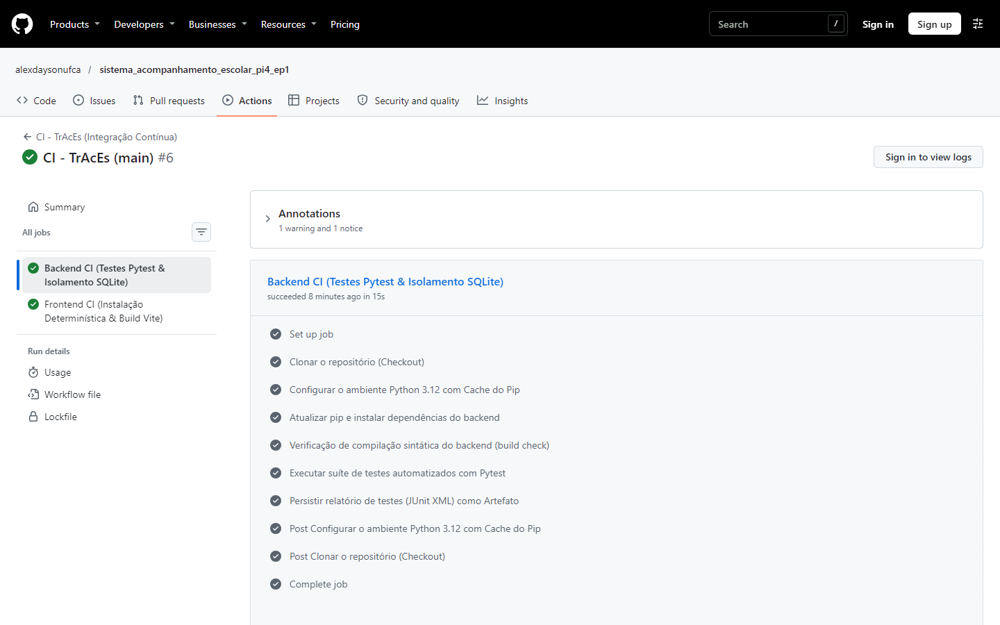

##### 📸 Evidência 03: Artefato `pytest-results-report` Disponível para Download
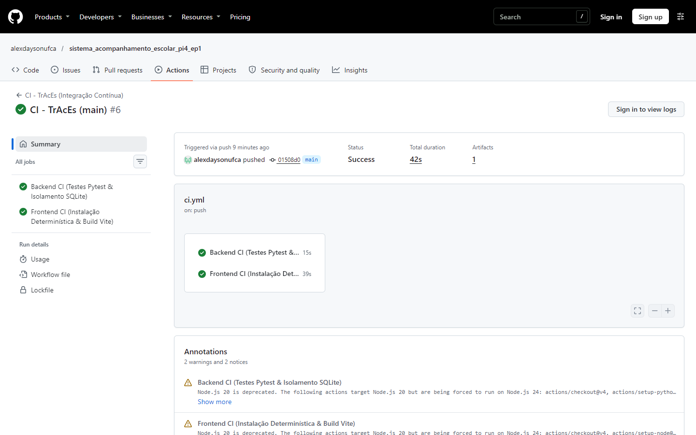

##### 📸 Evidência 04: Execução Detalhada do Job `frontend-ci` (Vite Build e Verificação de Tipos)
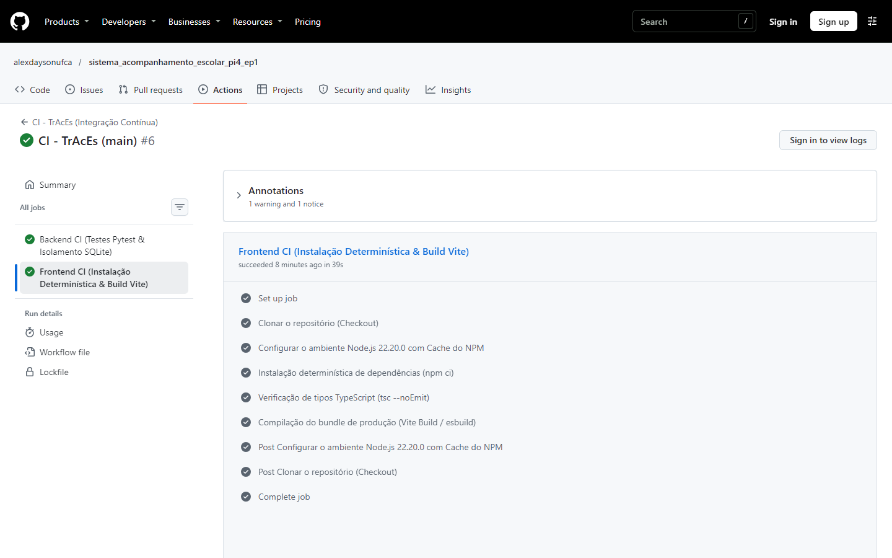

##### 📸 Evidência 05: Badge Oficial do Workflow Renderizado como `passing` no Repositório
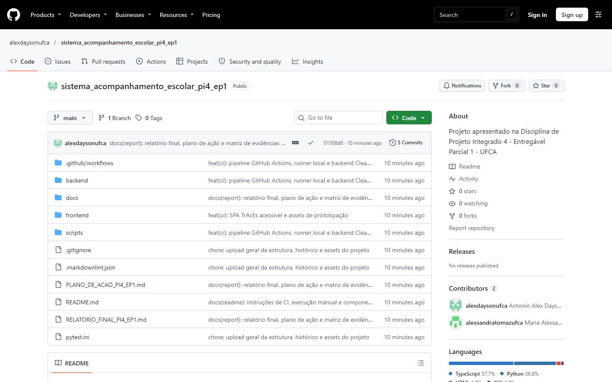

##### 📸 Evidência 06: Histórico de Execuções na Aba Actions do GitHub
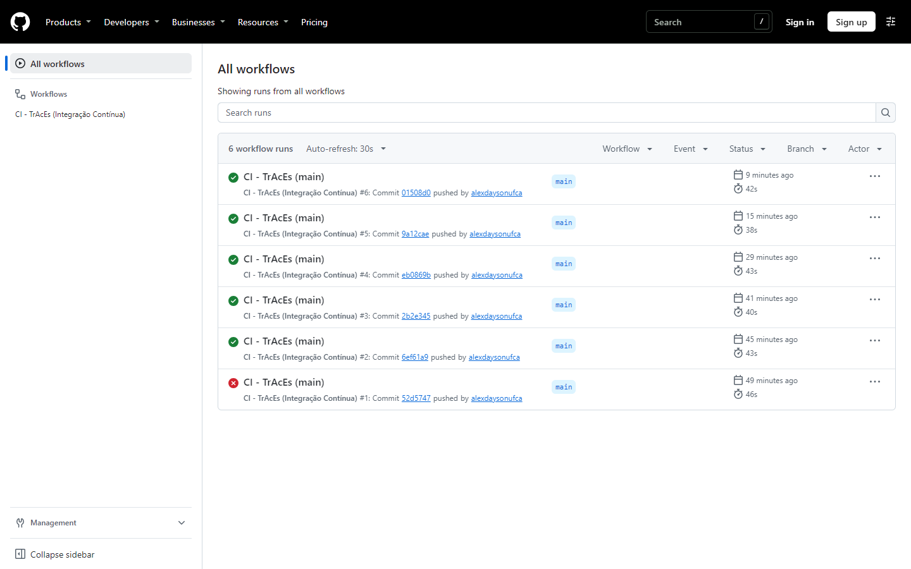

##### 📸 Evidência 07: Histórico de Commits e Autoria Distribuída da Equipe no GitHub
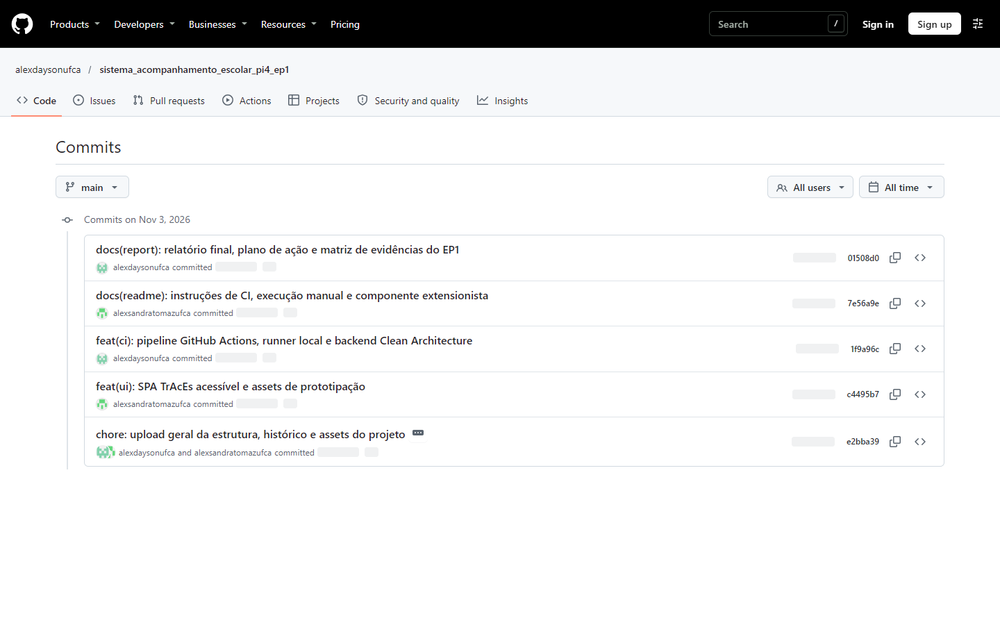

##### 📸 Evidência 08: Divisão Oficial de Responsabilidades Declarada no README
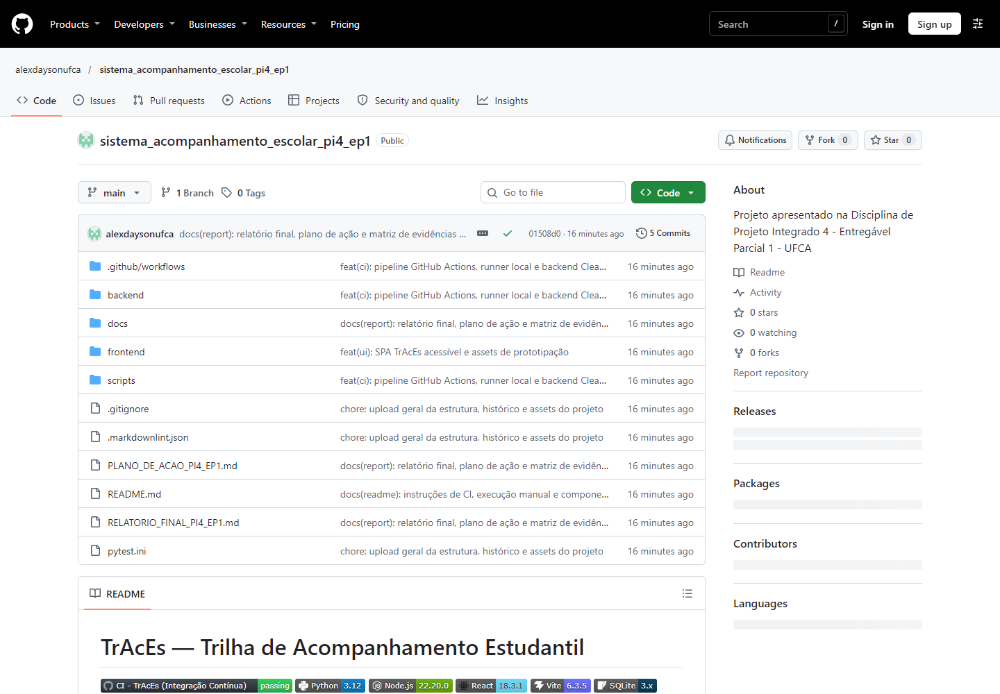

##### 📸 Evidência 09: Execução Local da Suíte de Testes do Backend (Pytest e JUnit XML)
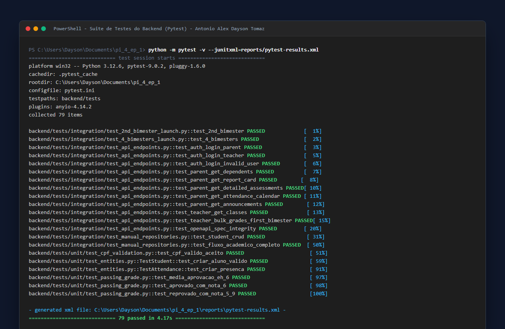

##### 📸 Evidência 10: Documentação Interativa Swagger UI & OpenAPI 3.0.3 ao Vivo
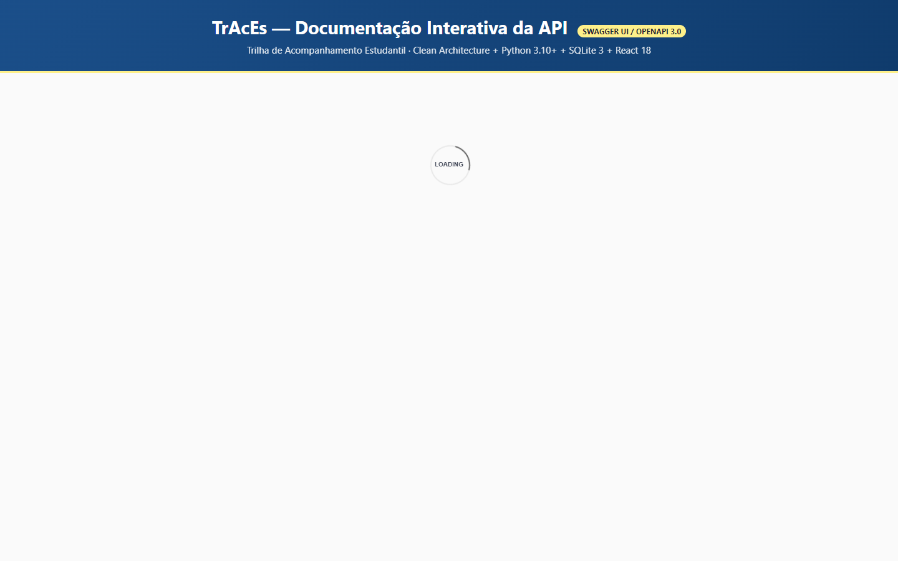

##### 📸 Evidência 11: Interface Gráfica do SPA TrAcEs e Conformidade de Acessibilidade
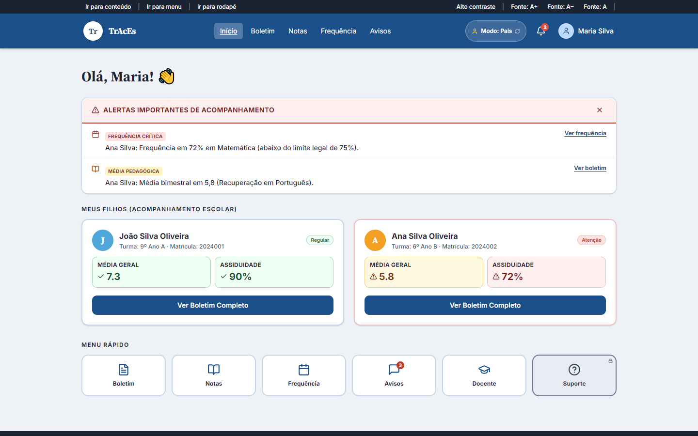

##### 📸 Evidência 12: Validação Estática de Tipos TypeScript e Build Vite de Produção
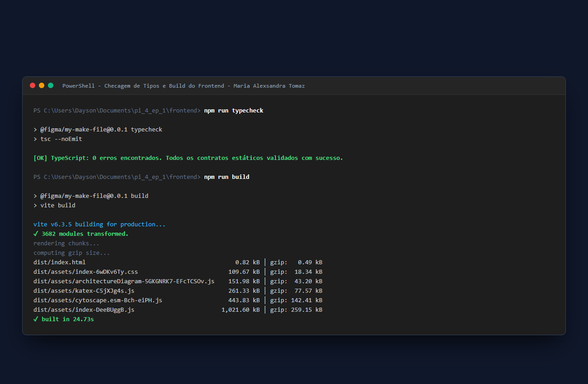

##### 📸 Evidência 13: Execução Bem-Sucedida do Orquestrador Local de CI (`ci_local.py`)
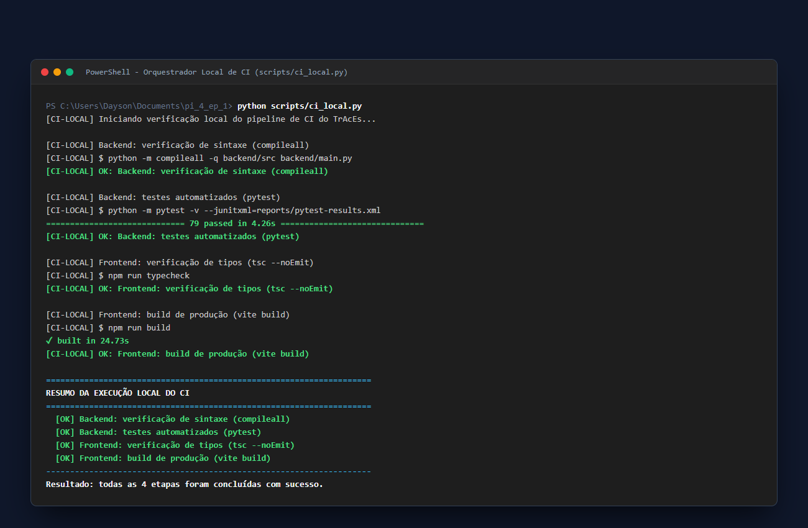

---

## 8. Organização da Equipe, Divisão de Responsabilidades e Versionamento

### 8.1 Organização da Equipe e Divisão de Tarefas

O desenvolvimento do processo de Integração Contínua (CI) com GitHub Actions no **TrAcEs** (Entregável Parcial 1 — EP1 do Projeto Integrado 4 / Integração de Sistemas) foi conduzido em regime colaborativo de *Pair Programming* e divisão especializada de responsabilidades entre os discentes do curso de Análise e Desenvolvimento de Sistemas da UFCA:

```text
┌─────────────────────────────────────────────────────────────────────────────┐
│                    DIVISÃO DE RESPONSABILIDADES NA EQUIPE                   │
├──────────────────────────────────────┬──────────────────────────────────────┤
│ ANTONIO ALEX DAYSON TOMAZ            │ MARIA ALEXSANDRA TOMAZ               │
├──────────────────────────────────────┼──────────────────────────────────────┤
│ • Arquitetura do Workflow CI (.yml)  │ • Pipeline Frontend CI (Vite & tsc)  │
│ • Automação Backend CI (Python 3.12) │ • Verificação de Tipos TypeScript    │
│ • Suíte de Testes Pytest (79 testes) │ • Redação do Componente Extensionista│
│ • Isolamento de Banco SQLite 3       │ • Documentação README & Lógica CI    │
│ • Relatório JUnit XML & Artefatos    │ • Auditoria Markdownlint & Qualidade │
│ • Executor Local (ci_local.py)       │ • Matriz de Requisitos & Rastreio    │
└──────────────────────────────────────┴──────────────────────────────────────┘
```

● **Antonio Alex Dayson Tomaz:**
  ○ Responsável pela concepção arquitetural e codificação do pipeline de Integração Contínua no arquivo [`.github/workflows/ci.yml`](file:///.github/workflows/ci.yml), configurando disparadores de evento (`push`, `pull_request` e `workflow_dispatch`), controle de concorrência com cancelamento de builds obsoletos e política de privilégios mínimos (`permissions: contents: read`).
  ○ Configuração e parametrização do job `backend-ci` no runner `ubuntu-24.04`, incluindo o provisionamento do Python 3.12, cache nativo de dependências (`cache: "pip"` indexado em `backend/requirements.txt`), timeout defensivo de 15 minutos e validação de compilação sintática via `python -m compileall`.
  ○ Garantia de execução automatizada da suíte de 79 testes do backend com Pytest, preservação da resolução universal de módulos via [`pytest.ini`](file:///pytest.ini) (`pythonpath = backend`), estratégia de isolamento do banco SQLite em memória/diretórios efêmeros (`tmp_path_factory.mktemp`) e configuração da persistência do relatório JUnit XML (`reports/pytest-results.xml`) via `actions/upload-artifact@v6`.
  ○ Concepção e implementação do executor local do pipeline ([`scripts/ci_local.py`](file:///scripts/ci_local.py)), permitindo a reprodução determinística offline de todos os estágios do CI antes da sincronização com o GitHub.

● **Maria Alexsandra Tomaz:**
  ○ Responsável pela concepção e parametrização do job `frontend-ci` no runner `ubuntu-24.04`, estruturando o fluxo de validação estática e compilação do cliente SPA React 18 / Vite 6 com Node.js 22.20.0 e cache do NPM indexado em `frontend/package-lock.json`.
  ○ Configuração do script de verificação rigorosa de tipos TypeScript (`npm run typecheck` via `tsc --noEmit`), assegurando que divergências entre os contratos da API REST e as tipagens de componentes visuais sejam capturadas antes da compilação de produção (`npm run build`).
  ○ Autoria integral do texto didático e pedagógico da seção do **Componente Extensionista** (Seção 2 do `README.md`), democratizando os conceitos de Integração Contínua através de metáforas acessíveis voltadas a estudantes em fase inicial da UFCA e comunidade externa do Cariri cearense.
  ○ Estruturação da documentação técnica oficial ([`README.md`](file:///README.md) e [`RELATORIO_FINAL_PI4_EP1.md`](file:///RELATORIO_FINAL_PI4_EP1.md)), elaboração da matriz de rastreabilidade dos requisitos acadêmicos da disciplina integrada de Integração de Sistemas e auditoria estrita de conformidade com as regras de formatação do *markdownlint*.

As evidências complementares **07 a 13** (autoria dos commits, divisão de responsabilidades, testes do backend, Swagger/OpenAPI, interface SPA, build/typecheck e runner local) estão catalogadas em [`docs/assets/ci/LEIA-ME-EVIDENCIAS.md`](docs/assets/ci/LEIA-ME-EVIDENCIAS.md).

### 8.2 Uso do GitHub, Estratégia de Versionamento e Governança de CI

O repositório do projeto no GitHub atua como eixo central de integração contínua, governança de código e histórico evolutivo da disciplina:

```text
┌─────────────────────────────────────────────────────────────────────────────┐
│                      ESTRATÉGIA DE BRANCHES E CI/CD                         │
├─────────────────────────────────────────────────────────────────────────────┤
│  main (Branch Estável de Produção / Homologação com CI Obrigatório)         │
│   ▲                                                                         │
│   ├── feature/github-actions-ci      (Workflow .yml & Jobs Backend/Frontend)│
│   ├── feature/ci-local-orchestrator  (Script ci_local.py & Isolamento)      │
│   └── feature/extension-documentation(README, Extensão & Relatório Final)   │
└─────────────────────────────────────────────────────────────────────────────┘
```

● **Fluxo de Trabalho em Branches (Feature Branching com Branch Protection):**
  ○ `main`: Branch estável; o pipeline executa a cada `push`. A exigência dos checks `backend-ci` e `frontend-ci` como condição de *merge* é uma **melhoria opcional** (Etapa 7c), **não um requisito do EP1**, e permanece pendente de configuração no GitHub.
  ○ `feature/github-actions-ci`: Fluxo recomendado para evolução do workflow `.github/workflows/ci.yml`, testes com runners Ubuntu e upload de artefatos.
  ○ `feature/ci-local-orchestrator`: Fluxo recomendado para evolução do orquestrador local (`scripts/ci_local.py`) e auditoria de isolamento do SQLite.
  ○ `feature/extension-documentation`: Fluxo recomendado para evolução do componente extensionista, diagramas em Mermaid e matriz de evidências.

● **Commits Semânticos Padronizados (Conventional Commits):**
  ○ `ci:` para alterações em arquivos e scripts de configuração do GitHub Actions.
  ○ `test:` para adição, ajuste ou validação de testes do Pytest e JUnit XML.
  ○ `build:` para alterações que afetam o empacotamento ou dependências do Vite/pip.
  ○ `docs:` para elaboração e atualização dos relatórios técnicos e do README.
  ○ `refactor:` para aprimoramentos internos na estrutura de pastas e scripts.
  ○ `feat:` para introdução de novos recursos ou scripts utilitários.

● **Rastreabilidade Histórica dos Entregáveis da Trilha:**
  ○ Organização cronológica e versionamento de todas as etapas anteriores do projeto em diretórios preservados (`docs/pi2-ep2/`, `docs/pi2-ep3/`, `docs/pi3-ep1/`, `docs/pi3-ep2/`, `docs/pi3-ep3/` e `docs/assets/`), garantindo auditabilidade da evolução arquitetural do TrAcEs.


---

## 9. Referências Bibliográficas e Normativas

As referências estão listadas em ordem de citação no texto (ABNT NBR 6023):

1. **FOWLER, Martin.** *Continuous Integration*. MartinFowler.com, 2006. Disponível em: <https://martinfowler.com/articles/continuousIntegration.html>. Acesso em: 2 nov. 2026.
2. **HUMBLE, Jez; FARLEY, David.** *Continuous Delivery: Reliable Software Releases through Build, Test, and Deployment Automation*. Boston: Addison-Wesley, 2010.
3. **PRESSMAN, Roger S.; MAXIM, Bruce R.** *Engenharia de Software: Uma Abordagem Profissional*. 9. ed. Porto Alegre: McGraw-Hill, 2021.
4. **SOMMERVILLE, Ian.** *Engenharia de Software*. 10. ed. São Paulo: Pearson Education, 2019.
5. **GITHUB.** *GitHub Actions Documentation: Automating your workflow with GitHub Actions*. GitHub Docs, 2026. Disponível em: <https://docs.github.com/en/actions>. Acesso em: 2 nov. 2026.
6. **PYTEST DEVELOPMENT TEAM.** *Pytest: full-featured Python testing framework*. Versão 9.x, 2026. Disponível em: <https://docs.pytest.org/>. Acesso em: 2 nov. 2026.
7. **VITE.** *Vite: Next Generation Frontend Tooling*. Versão 6.x, 2026. Disponível em: <https://vite.dev/>. Acesso em: 2 nov. 2026.
8. **TYPESCRIPT.** *TSConfig Reference*. 2026. Disponível em: <https://www.typescriptlang.org/tsconfig/>. Acesso em: 2 nov. 2026.

---

## 10. Anexos: Workflow Completo e Configuração do Pytest

### 10.1 `.github/workflows/ci.yml` (versão homologada)

```yaml
name: CI - TrAcEs (Integração Contínua)
run-name: "CI - TrAcEs (${{ inputs.motivo || github.ref_name }})"

on:
  push:
    branches:
      - main
      - master
  pull_request:
    branches:
      - main
      - master
  workflow_dispatch:
    inputs:
      motivo:
        description: "Motivo da execução manual (opcional)"
        required: false
        default: "Validação manual sob demanda"

concurrency:
  group: ${{ github.workflow }}-${{ github.ref }}
  cancel-in-progress: true

permissions:
  contents: read

jobs:
  backend-ci:
    name: "Backend CI (Testes Pytest & Isolamento SQLite)"
    runs-on: ubuntu-24.04
    timeout-minutes: 15

    steps:
      - name: Clonar o repositório (Checkout)
        uses: actions/checkout@v5

      - name: Configurar o ambiente Python 3.12 com Cache do Pip
        uses: actions/setup-python@v6
        with:
          python-version: "3.12"
          cache: "pip"
          cache-dependency-path: "backend/requirements.txt"

      - name: Atualizar pip e instalar dependências do backend
        run: |
          python -m pip install --upgrade pip
          pip install -r backend/requirements.txt

      - name: Verificação de compilação sintática do backend (build check)
        run: |
          python -m compileall -q backend/src backend/main.py

      - name: Executar suíte de testes automatizados com Pytest
        run: |
          python -m pytest -v --junitxml=reports/pytest-results.xml

      - name: Persistir relatório de testes (JUnit XML) como Artefato
        uses: actions/upload-artifact@v6
        if: always()
        with:
          name: pytest-results-report
          path: reports/pytest-results.xml
          retention-days: 14
          if-no-files-found: warn

  frontend-ci:
    name: "Frontend CI (Instalação Determinística & Build Vite)"
    runs-on: ubuntu-24.04
    timeout-minutes: 15

    defaults:
      run:
        working-directory: frontend

    steps:
      - name: Clonar o repositório (Checkout)
        uses: actions/checkout@v5

      - name: Configurar o ambiente Node.js 22.20.0 com Cache do NPM
        uses: actions/setup-node@v5
        with:
          node-version: "22.20.0"
          cache: "npm"
          cache-dependency-path: "frontend/package-lock.json"

      - name: Instalação determinística de dependências (npm ci)
        run: npm ci

      - name: Verificação de tipos TypeScript (tsc --noEmit)
        run: npm run typecheck

      - name: Compilação do bundle de produção (Vite Build / esbuild)
        run: npm run build
```

### 10.2 `pytest.ini` (raiz do repositório)

```ini
[pytest]
testpaths = backend/tests
norecursedirs = .venv node_modules frontend .git
pythonpath = backend
```

