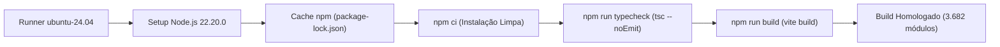

<!-- markdownlint-disable -->

# Relatório de Tecnologias do Frontend e Esteira de CI — TrAcEs (PI4 - EP1)

**Projeto:** TrAcEs — Trilha de Acompanhamento Estudantil  
**Entregável:** Entregável Parcial 1 (EP1) — Especificação Técnica da Camada de Apresentação e Esteira de CI  
**Disciplina:** Projeto Integrado 4  
**Disciplina Integrada:** Integração de Sistemas  
**Instituição:** Universidade Federal do Cariri (UFCA)  
**Curso:** Análise e Desenvolvimento de Sistemas  
**Estudantes:** Antonio Alex Dayson Tomaz e Maria Alexsandra Tomaz  
**Data:** 02/11/2026  
**Status do Frontend:** ✅ 100% FUNCIONAL E HOMOLOGADO NO GITHUB ACTIONS (React 18 + Vite 6 + Tailwind CSS v4 + TypeScript 5 + WCAG 2.1 AA + Job `frontend-ci` Verde)

---

## 1. Visão Geral da Camada de Apresentação e Automação de CI

O Frontend do **TrAcEs** é uma **Single Page Application (SPA)** de alta fidelidade e acessibilidade prática, desenvolvida para fornecer uma experiência fluida, reativa e inclusiva tanto para o público familiar (responsáveis legais) quanto para o corpo docente (professores).

No âmbito do **EP1 do Projeto Integrado 4 / Integração de Sistemas**, o cliente SPA foi dotado de uma esteira rigorosa de **Integração Contínua (CI)** que inspeciona a integridade estática dos contratos de tipo via TypeScript (`tsc --noEmit`) e valida o empacotamento para produção com Vite (`vite build`) a cada novo commit.

---

## 2. A Esteira de CI do Frontend no GitHub Actions

O job `frontend-ci` configurado em [`.github/workflows/ci.yml`](../../.github/workflows/ci.yml) implementa as melhores práticas de Engenharia de Software Moderna:



### 2.1 Pilares da Automação do Frontend
1. **Instalação Determinística com `npm ci`:** Ao contrário do `npm install`, o `npm ci` consome estritamente o arquivo de trava `package-lock.json`, garantindo que todas as dependências instaladas no runner de CI sejam idênticas às testadas no ambiente local da equipe.
2. **Cache Nativo de Módulos:** `actions/setup-node@v4` indexa o cache do NPM pelo hash de `frontend/package-lock.json`, reduzindo o tempo de download de minutos para ~15 segundos.
3. **Verificação Estática de Tipos (`tsc --noEmit`):** Executada via `npm run typecheck`, confere todos os contratos entre a API REST e os componentes visuais antes da compilação, interceptando potenciais inconsistências em tempo de build.
4. **Compilação Otimizada de Produção (`vite build`):** Transforma e minifica os 3.682 módulos da aplicação em chunks otimizados com suporte a dynamic imports e gzip.

---

## 3. Estrutura de Diretórios do Frontend

```text
frontend/
├── index.html                     # Entrypoint HTML5 semântico com meta tags e fontes
├── package.json                   # Dependências e scripts de execução (typecheck, build, dev)
├── package-lock.json              # Trava determinística de dependências para o npm ci
├── vite.config.ts                 # Configuração do Vite com host: true e proxy reverso (/api, /docs)
├── postcss.config.mjs             # Configuração do Tailwind CSS
├── default_shadcn_theme.css       # Tokens e variáveis do Shadcn UI
├── public/                        # Ativos públicos e imagens vetoriais SVG
│   ├── docs/                      # Documentação técnica espelhada
│   └── img/                       # Vetores SVG da aplicação
└── src/
    ├── main.tsx                   # Ponto de inicialização do React 18 e montagem na DOM
    ├── app/
    │   ├── App.tsx                # Componente principal contendo as telas, modais e acessibilidade
    │   └── components/            # Primitivas acessíveis Radix / Shadcn UI
    ├── services/
    │   └── api.ts                 # Cliente HTTP assíncrono tipado com os endpoints REST
    ├── types/
    │   └── api.ts                 # Interfaces TypeScript estritas para contratos da API
    └── styles/
        ├── globals.css            # Design System, tokens Tailwind v4 e estilos de Alto Contraste
        └── theme.css              # Variáveis de tema e cores acessíveis
```

---

## 4. Tecnologias e Frameworks Utilizados

| Tecnologia / Biblioteca | Versão | Papel na Arquitetura do Frontend |
| :--- | :---: | :--- |
| **React** | `18.3.1` | Biblioteca base para criação da interface declarativa baseada em componentes reativos. |
| **TypeScript** | `5.x` | Tipagem estática rigorosa para contratos de API, estados e propriedades de componentes. |
| **Vite** | `6.3.5` | Bundler e servidor de desenvolvimento ultrarrápido com Hot Module Replacement (HMR) e proxy reverso. |
| **Tailwind CSS** | `4.1.12` | Framework CSS utilitário para estilização performática e design tokens. |
| **Lucide React** | `0.487.0` | Conjunto completo de ícones SVG semânticos de alta legibilidade. |
| **Radix UI Primitives** | `1.x` | Primitivas headless acessíveis (Dialog, Select, Dropdown, Tabs, Tooltip). |

---

## 5. Acessibilidade Digital SPA (WCAG 2.1 AA) e Usabilidade (Nielsen)

- **Modo Alto Contraste Nativo:** Relação de contraste superior a 7:1 em todos os elementos de texto e controle interativo.
- **Barra de Acessibilidade Fixa:** Acesso rápido a Alto Contraste, redimensionamento de fonte (80% a 140% em `rem`) e Skip Links.
- **Codificação Semântica Tripla:** Informações representadas simultaneamente por cor, ícone gráfico e texto explícito.
- **Prevenção de Erros (Nielsen #5):** Modais de confirmação prévia com Focus Trap antes de alterações permanentes.

---

## 6. Conclusão

A arquitetura do Frontend do TrAcEs combina uma experiência de usuário rica e acessível com uma esteira de automação industrial no GitHub Actions, garantindo que o software permaneça confiável e resiliente a cada ciclo de desenvolvimento.
